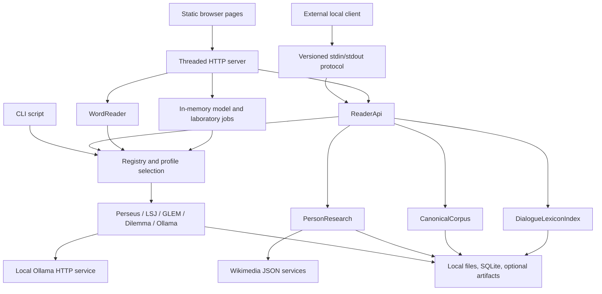

# PlatoSI codebase audit

Audited **4 November 2026**. Baseline HEAD: `b008de68ad9c9a2e876e6a00da8bd643a67a687c` (`Add dialogue-grounded lexical research`). This report describes the working tree, including pre-existing changes in `src/platosi/person_research.py`, `src/platosi/reader_api.py`, and `tests/test_person_research.py`. The pre-existing README was reviewed as documentation, not accepted as proof. Only `README.md` and this document were changed for this audit.

## 1. Method, status, and coverage

Application-owned source was read in full: all 18 `src/platosi/*.py` modules, all five provider implementations and manifests, all 13 scripts, all ten browser assets, all 12 Python test files, the JavaScript contract test, and its JSON fixture. Repository inventory included all 86 initially tracked files, `.gitignore`, documentation, local data directories, configuration, and distribution artifacts. No `AGENTS.md` was found in the repository or checked ancestor locations. No application files were edited.

Features were traced from HTML/event handlers or command/protocol entry points into dispatchers, providers, and storage. Definitions and comments alone were not counted as wired functionality. JSON inventories/reports were parsed and their structure inspected; generated reports were treated as historical records, not current execution evidence. Downloaded input bytes were hash-verified. Every canonical work was loaded through production validation and independently re-extracted from its installed source XML. SQLite schemas/table counts were inspected read-only. The audit did not perform a scholarly reading of every corpus/dictionary entry or a source audit of installed third-party packages.

Status terminology:

| Status | Meaning in this report |
| --- | --- |
| **Implemented** | A concrete execution path exists and is reachable through the stated interface. This does not certify correctness for every input. |
| **Partially implemented** | A useful path exists, but a material subpath, provisioned dependency, or integration is incomplete. |
| **Placeholder** | Displayed or declared, with no working feature behind it in this repository. |
| **Uncertain** | Source or environment evidence is insufficient to establish the claimed outcome. |

“Observed” findings follow directly from inspected code or an executed check. “Inferred risk” identifies an implication of the implementation that was not reproduced as an end-to-end failure. “Not verified” identifies a coverage boundary. API-only implementation is distinguished from browser integration throughout.

### Coverage ledger

| Inspected area | Files and relevant symbols |
| --- | --- |
| Core entry/routing | [cli.py](src/platosi/cli.py): `main`, `print_inquiry`; [playground.py](src/platosi/playground.py): `Playground`, `Server`, `Handler`, `serve`; [reader_api.py](src/platosi/reader_api.py): `ReaderApi`; [reader_protocol.py](src/platosi/reader_protocol.py): `serve` |
| Shared infrastructure | [registry.py](src/platosi/registry.py): `RegisteredProvider`, `Registry`; [profiles.py](src/platosi/profiles.py): `Profiles`, `select`; [contracts.py](src/platosi/contracts.py): provider protocols; [storage.py](src/platosi/storage.py): index/hash helpers; [cancellation.py](src/platosi/cancellation.py): cancellation token; [__init__.py](src/platosi/__init__.py): version |
| Text and linguistic services | [canonical_build.py](src/platosi/canonical_build.py): `Collector`, `extract_segments`; [canonical_text.py](src/platosi/canonical_text.py): `CanonicalCorpus`, hash/offset helpers; [unicode_search.py](src/platosi/unicode_search.py): normalization/matching; [word_reader.py](src/platosi/word_reader.py): `WordReader`; [dialogue_lexicon.py](src/platosi/dialogue_lexicon.py): `DialogueLexiconIndex` |
| Model/research services | [inquiry.py](src/platosi/inquiry.py): `inquire`; [word_models.py](src/platosi/word_models.py): `Examination`; [person_research.py](src/platosi/person_research.py): `PersonResearchCache`, `PersonResearch` |
| Plugins | `plugin.json` and `provider.py` in [perseus-plato](plugins/perseus-plato/), [lsj-logeion](plugins/lsj-logeion/), [glem](plugins/glem/), [dilemma](plugins/dilemma/), and [ollama](plugins/ollama/) |
| Browser assets | [lookup.html](playground/lookup.html), [lookup.js](playground/lookup.js), [reader.html](playground/reader.html), [reader.js](playground/reader.js), [index.html](playground/index.html), [app.js](playground/app.js), [dilemma.html](playground/dilemma.html), [dilemma.js](playground/dilemma.js), [login.html](playground/login.html), [style.css](playground/style.css) |
| Launch/build/package scripts | [platosi.py](scripts/platosi.py), [playground.py](scripts/playground.py), [reader_api.py](scripts/reader_api.py), [build-canonical-corpus.py](scripts/build-canonical-corpus.py), [check-local-dependency.py](scripts/check-local-dependency.py), [package-platosi.py](scripts/package-platosi.py) |
| Acquisition/validation scripts | `download-plato.ps1`, `download-lsj.ps1`, `download-morphology.ps1`, `validate-plato.ps1`, `validate-lsj.ps1`, `validate-morphology.ps1`, `plato-common.ps1`, all under [scripts/](scripts/) |
| Tests | Every file is identified by purpose in section 8, including [text_location_contract.mjs](tests/text_location_contract.mjs) and [fixture](tests/fixtures/text-location-v1.json). |
| Configuration/data evidence | All plugin manifests, local `data/plugin-config.json`, all eight `docs/*.json` inventories/reports/sample files, installed canonical work/source files, provider indexes, cache schemas/counts, and `.gitignore`. No reader-profile JSON is currently present. Cache content was not exhaustively reviewed. |
| Supporting prose | Existing README; `docs/local-dependency.md`, `text-location-contract.md`, `retrieval.md`, `lemma-dialogue-index-plan.md`, `vision-and-integration-plan.md`, `morphology-research.md`, `glem-licensing-review.md`, `dilemma-phase1-evaluation.md`. These contain plans and historical claims that were checked against code where relevant; their external assertions were not independently re-researched. |
| Non-runtime artifacts | `.gitkeep` files; existing `dist` ZIP/checksum. The ZIP was inspected as a packaged snapshot, not assumed to match current code. Git internals, bytecode, external Chora, and third-party package/model internals are outside application-source coverage. |

## 2. Application architecture

### 2.1 Initialization and interfaces

The application is a source-tree Python package, version `0.1.0.dev1` in `src/platosi/__init__.py`. There is no `pyproject.toml`, root `setup.py`, dependency requirements/lockfile, frontend package manifest, CI workflow directory, or root application `LICENSE` in this checkout. The launch scripts explicitly insert `<root>/src` into `sys.path`.

`scripts/platosi.py` calls `cli.main`. The CLI accepts `--root`, discovers providers for most commands, and emits JSON except for the readable default inquiry response. Profile commands operate directly on `Profiles`. Index commands call one enabled provider's `build`; other operations select providers supporting the capability.

`scripts/playground.py` parses `--port` (8765 by default) and `--lan`, then calls `playground.serve`. `Playground` owns an in-memory job dictionary, `WordReader`, `ReaderApi`, and `Examination`. The standard-library `ThreadingHTTPServer` serves a fixed static-file map and JSON routes. There is no framework, bundler, browser router, or background task service.

`scripts/reader_api.py` starts `reader_protocol.serve` over binary stdin/stdout. This is a separate transport from browser HTTP. A shared `ReaderApi` instance dispatches requests through a four-worker executor; each `execute` normally constructs a fresh registry. `canonical.*` and `system.info` bypass registry construction, allowing canonical text operations despite unrelated malformed plugins.

### 2.2 Provider abstraction and selection

`Registry.__init__` scans sorted `plugins/*/plugin.json`, checks required top-level fields and duplicate IDs, shallow-merges per-provider `config` overrides from `data/plugin-config.json`, and computes enablement from overrides or manifest defaults. `RegisteredProvider.load` dynamically imports `module` and calls `create_provider(manifest, root)`, caching the instance under a lock. This is executable local extension code, not an isolated plugin sandbox.

`contracts.py` supplies typing protocols for corpus, dictionary, morphology, reading, language models, chat, and scholarly retrieval. These are not runtime-enforced interfaces. Newer capabilities (`lemma_forms`, `lemma_relations`, `match_forms`, `evaluate`) are used by convention without corresponding complete typed protocols here.

`profiles.select` preserves requested ordering and reports missing, disabled, unsupported, unavailable, text-first-suppressed, and optionally provider-error states. An explicit nonempty include list replaces a profile selection; exclusion removes IDs. Text-first suppresses non-corpus types unless explicitly included. Enablement is never bypassed. Unknown resource IDs remain valid saved preferences. `WordReader._select` specially treats an explicitly supplied empty `include` list as selecting nothing; ordinary `select` treats an empty list as no override.

Registry lifetime varies: CLI uses a registry for one invocation; `ReaderApi.execute` creates one per request; `WordReader` reuses a registry until manifest/config file size or modification time changes; `Playground._dilemma_registry` caches one without a refresh check. Long-lived processes therefore have different configuration-refresh behavior.

### 2.3 Two text models and coordinate systems

The Perseus adapter uses revision `a6eb0cc3e6f6e382934a2c8b33577d2fb4371e00` from its manifest. `extract` concatenates all TEI body descendant text, records hierarchical `div type="textpart"` spans, exact-case `resp="Stephanus"` milestones, and selected editorial markup. It inserts no synthetic whitespace. SQLite stores original text plus exact/accentless normalized keys, citation declarations, markup, and division/milestone JSON. `record` returns original match text with surrounding textpart context; match offsets refer to returned `text` in Python code points. `reading` returns a selected division with scope-relative code-point offsets.

Canonical text uses independent revision `9a424880e535b7b24258feda413fa37580f8971f` from `docs/canonical-corpus-v1-inventory.json`. `canonical_build.extract_segments` walks `p`, `sp`, and `lg` blocks, handles section/paragraph milestones, collapses source whitespace, preserves explicit/verse breaks, normalizes NFC, and annotates quotation/citation spans. Books are recorded when present; otherwise chapter `1` is assigned. Segments sharing contiguous Stephanus references form one section; section text joins segments with LF.

`canonical_text.text_version` hashes contract ID, dialogue ID, section count, and length-prefixed UTF-8 reference/text bytes. `segment_digest` separately covers segment text, annotations, and divisions. `make_work` checks both against the frozen inventory. `CanonicalCorpus.work` rebuilds and compares the complete stored object before returning it. `resolve` requires exactly dialogue/version/start/end, checks known sections and valid UTF-16 boundaries, rejects reversed ranges, and joins cross-section selections with LF. Empty ranges are allowed. Returned context contains the boundary sections, not every intervening section.

Canonical catalog availability checks file existence for all inventory works; work loads perform actual integrity validation. `any_available` only checks whether at least one work file exists. There is no multi-version archive or anchor-migration implementation; a different requested version is rejected. Guided browser reading uses indexed editions, not the canonical catalogue.

### 2.4 State, concurrency, and data flow

The four page scripts own their UI state in module-level variables. Fetch calls return JSON; results are rendered with DOM/text nodes. Dictionary XML is parsed for text excerpts, not inserted as executable HTML. Conversation formatting recognizes simple bold/italic/inline-code spans, not full Markdown. Reader selection and lookup sequence counters suppress stale results. Laboratory history is a 30-item in-memory array.

HTTP model/examination/laboratory jobs get random IDs and daemon threads. Status/result updates use a lock. `get` returns only status/result/error. `stop` immediately marks a running job cancelled and signals its token. Model chat can check this token during network waits; Dilemma computation receives no token internally. Completed jobs are pruned when a new job starts, using creation-time cutoffs (300 seconds for conversation/examination; 1,800 for laboratory submission). Running jobs are retained. There is no global HTTP queue/concurrency cap.

The process protocol instead caps pending work at 16 and uses four workers. It serializes writes, echoes request IDs, allows out-of-order completions, validates version 1, and sends `invalid`, `failed`, or `cancelled` terminal envelopes. `request.cancel` acknowledges whether the target was pending; the target still gets its own terminal response. EOF cancels tokens and waits for workers; non-cooperative operations can delay exit. An envelope `ok` can contain an operation-level `unavailable`, `partial`, or `failed` result.

## 3. Feature inventory

Each row names the actual feature, describes interaction and behavior, identifies implementation/files, states dependencies, and gives status. Dependencies refer to installed/configured availability, not merely presence of a plugin folder.

### 3.1 Text and lexical retrieval

| Feature | Description and user interaction | Implementation / relevant files and symbols | Dependencies | Status |
| --- | --- | --- | --- | --- |
| Greek word/phrase search | Home page form; CLI `search`; process `text.search`. Finds literal normalized text across installed Greek editions and returns attributed matches/context. Browser/process API use exact mode and 20 results per provider; CLI supports both modes and a configurable limit. | `plugins/perseus-plato/provider.py`: `search`, `record`; `src/platosi/unicode_search.py`: `normalize`, `matches`; `ReaderApi.execute`; `playground/lookup.js`: search handler | Perseus source directory and current SQLite index | Implemented |
| Accent-insensitive matching | CLI `--mode accent-insensitive` for search/lookup/analyze. Removes all combining marks while retaining case; can conflate distinct forms. Dilemma rejects this mode. | `unicode_search.normalize`; `cli.main`; provider `search` / `lookup` / `analyze` | Supporting provider | Implemented, provider-dependent |
| Passage lookup | Home page accepts a Republic citation; CLI/process accept an arbitrary edition and citation. Resolves exact dot-joined textpart path first, otherwise Stephanus section; no fuzzy citation resolution. | `PlatoProvider.passage`; `ReaderApi.execute` (`text.passage`); `lookup.js`: passage handler, `showPassages` | Indexed edition with matching division/milestone | Implemented |
| Source evidence and editorial markers | Result records include provider/version, repository/revision, licensing, source path, edition, citations, original match/context, and recognized markup. Browser exposes selected metadata or complete records. | `PlatoProvider.record`, `reading`; `WordReader.occurrence`; `lookup.js`: `source`; `reader.js`: `detail`; `app.js`: `addEvidence` | Underlying record metadata | Implemented; not complete TEI interpretation |
| LSJ headword lookup | CLI `lookup`, home-page word result, reader dictionary panel, and API evidence. Matches complete normalized headword; duplicate upstream IDs remain separate records. | `plugins/lsj-logeion/provider.py`: `build`, `lookup`; `ReaderApi.analyze`; `WordReader.explore` | Local LSJ XML and current index | Implemented |
| Explicit orthographic aliases | Query an alias extracted from a direct `orth` child. Internal hyphens are removed; fragments beginning/ending with hyphen are excluded. Results retain alias classification and source fragment. | LSJ `orthographic_aliases`, `greek_headword`, `lookup` | Alias table generated by current LSJ builder | Implemented |
| Word analysis plus dictionary expansion | Home page/API `word.analyze`: analyze supplied form, gather that form plus candidate lemmas, query dictionaries within a shared 20-record per-provider dictionary budget. Return partial/unavailable sections and limitations. | `ReaderApi.analyze`, `collect`, `lookup_entries`; `lookup.js`: `showWord` | At least one morphology or dictionary source; either side can be unavailable | Implemented |
| GLEM candidate analysis | CLI `analyze` or selected reader/API source. Returns exact/accentless form mappings with raw tag and source-line attribution. Does not disambiguate context. | `plugins/glem/provider.py`: `build`, `analyze` | Pinned merged list and index; enablement | Implemented; disabled by default and locally |
| Dilemma candidate analysis | Same analysis surfaces when enabled. Exact NFC form only; verbose calls under article resolution false/true, `skip_pos=True`, `guess=False`; preserves settings and lookup/rule classifications, then applies result limit. | `plugins/dilemma/provider.py`: `analyze`, `_analyze`, `_engine` | Version-pinned Dilemma package and configured artifacts | Implemented adapter; candidate completeness unverified |
| Direct lemma/form matching | Process `lemma.matchForms` takes 1–500 distinct forms plus a lemma; reader occurrence lookup uses provider capability directly with all distinct scope forms. Validates process result mappings and restores original requested forms. | `ReaderApi.match_forms`; GLEM/Dilemma `match_forms`; `WordReader.occurrences` | Enabled mapping provider and its data | Implemented |
| Reverse lemma-form inventories | Internal `lemma_forms` capability used by dialogue lexicon. GLEM selects list rows; Dilemma selects direct lookup rows for `grc`/`all`. Raises if more than 10,000 requested records would be returned through the API path. | GLEM/Dilemma `lemma_forms`; `ReaderApi.dialogue_lexicon`: `load_forms` | Direct mapping databases | Implemented; no standalone UI or named process operation |
| Explicit lexical relations | LSJ extracts Greek `etym lang="grc"` targets only when the whole target is a valid headword and another indexed entry exists. Preserves directed edge, source entry identity, XML fragment. | LSJ `lemma_relations`, `greek_headword`; `ReaderApi.RELATION_TYPES` | Current LSJ index | Implemented narrow subset; ten relation types accepted, only `etymological_relation` emitted by supplied providers |

Recognized editorial tags in indexed text are `del`, `add`, `label`, `bibl`, `sic`, `corr`, `head`, and `gap`. Search matches overlapping nonempty spans get `editorial_text`; source text remains available. `passage` records use `primary_text` even if their span includes editorial material because `record` conditions that classification on a search mode. This is an observed classification inconsistency, not evidence that passage text is missing.

### 3.2 Reading and browser-owned features

| Feature | Description and user interaction | Implementation / relevant files and symbols | Dependencies | Status |
| --- | --- | --- | --- | --- |
| Republic book reader | `/reader` offers Books 1–10 and automatically opens the initial scope. Greek tokens become buttons; intervening source characters are retained. | `playground/reader.html`; `reader.js`: `initialize`, `openReading`; `WordReader.scope`; `PlatoProvider.reading` | Enabled `reading` corpus and indexed Republic edition | Implemented |
| Manual alternative readings | Expand source settings, choose provider, enter another edition URN and division, and open it. There is no generated work catalogue/edition picker here. | `reader.html`: custom fields; `reader.js`: `query`; `WordReader.scope` | Known indexed edition/division | Implemented manual path; guided catalogue absent |
| Click-to-explore word evidence | Select a Greek token at its exact scope start; retrieve analyses, entries for surface/candidate lemmas, citations, markup, and errors without needing a model. Limits are 1,000 analysis records per provider and 1,000 entries per query/provider. | `WordReader.explore`, `tokens`, `occurrence`; `reader.js`: `selectWord`, `renderWord` | Current reading and selected analysis/dictionary providers | Implemented |
| Dictionary sense display | Group entries with exact NFC candidate headwords; show first three sense excerpts, reveal further senses, and expose full source JSON. Home page uses a 600-code-point excerpt and optional full plain text instead. | `reader.js`: `dictionaryExcerpts`, `renderDictionaryEntry`; `lookup.js`: `showWord` | Entry XML from dictionary | Implemented; excerpts are display reductions, not selected meanings |
| Etymology reference display | Reader displays text around all `etym` elements in returned entries and explicitly does not label these as identified roots. | `reader.js`: `etymologyReferences`, `renderWord` | Dictionary XML containing etym elements | Implemented; separate from stricter relation API |
| Within-scope occurrences | Click “Find this word in the book” for a candidate. Match provider lemma mappings against actual scope tokens, show source contexts and citations, click to focus/select a matching word. No compounds/roots merged automatically. | `WordReader.occurrences`, `citation_at`; `reader.js`: `findOccurrences` | Selected scope and `match_forms` provider | Implemented; scope-local and mapping-dependent |
| Browser notes | Type a note for selected word and click Save. On selecting that position again, load it from localStorage. No model request receives this note. | `reader.js`: `noteKey`, `selectWord`, save handler | Browser storage for current HTTP origin | Implemented; per provider/edition/scope/code-point position |
| Remembered exploration choice | Occurrence search saves chosen lemma under the same position key with `:lemma`; subsequent display marks it as saved. Does not select an authoritative reading. | `reader.js`: `findOccurrences`, `renderWord` | localStorage | Implemented |
| Resource/profile controls | Reader/conversation choose existing profiles or explicit enabled resource checkboxes. Reader supports explicit empty selection. Profile creation and provider activation remain CLI tasks. | `reader.js`: `selection`, `query`; `app.js`: `resourceSelection`; `Profiles`, `select`; HTTP options/bootstrap | Local profile JSON, manifests/config | Implemented; defaults differ across surfaces |
| Cross-book/work AI relationships | Reader displays “AI exploration of connections across a book or the whole work is not available yet.” No associated action or computation follows. | `reader.js`: `renderWord` | No implementation wired | Placeholder |
| Responsive layout and accessible controls | CSS switches layouts below 800px; HTML supplies labels, landmarks, status/live regions; Greek words use focusable buttons. | `playground/style.css`; five HTML files; reader token rendering | Browser CSS/DOM | Implemented markup; visual/accessibility usability not manually verified |

### 3.3 Model interactions

| Feature | Description and user interaction | Implementation / relevant files and symbols | Dependencies | Status |
| --- | --- | --- | --- | --- |
| Local model discovery | CLI `models`, conversation bootstrap, reader “Find available models.” Returns names, details, digests from local Ollama and filters remote/cloud declarations. | `inquiry.model_provider`; `Playground.bootstrap`; `OllamaProvider.list_models`; page initialization/discovery handlers | Enabled model provider, running local Ollama, installed models | Implemented; live discovery succeeded |
| Free multi-turn conversation | `/conversation`, free mode. Editable system prompt, model, temperature 0–2, token limit 1–8192; current history accompanies each turn; no scholarly retrieval. | `app.js`: submit handler/history, `appendMessage`; `Playground.validate`, `run` | Provider with `chat` | Implemented |
| Grounded inquiry | CLI `inquire`, conversation grounded mode, process `inquiry.ask`. Retrieve corpus evidence plus requested resources, send attributed evidence with instructions, return answer/model/warnings. | `inquiry.inquire`, `evidence_record`; `Playground.run`; `ReaderApi.ask` | Corpus evidence and appropriate enabled model capability | Implemented; semantic grounding unverified |
| Evidence citation diagnostics | Unknown `[E<number>]` or no citations produces warnings; passage spans are bounded before model input. Search context is labelled as surrounding textpart. | `inquiry.evidence_record`, final checks in `inquire`; `app.js`: `addEvidence`; CLI `print_inquiry` | Model output and evidence package | Implemented syntactic checks, not entailment validation |
| Conversation stop/reset | Stop signals job cancellation; New Conversation clears UI history and cancels current or late-starting job. History otherwise persists only until tab reload. | `app.js`: stop/new handlers, `poll`; `Playground.stop`; `Cancellation` | Existing in-memory job; cooperative adapter | Implemented |
| Independent word assessments | Reader AI panel selects primary/validation models, sends same evidence separately, validates complete JSON assessments, displays statuses/reasons and agreement/disagreement. No primary output is supplied to validation. | `word_models.evidence_package`, `assessment_schema`, `parse_assessment`, `compare`, `Examination.run`; reader examination handler | Candidate analyses and selected chat providers/models | Implemented; calls sequential and same model allowed |
| Assessment cache/fresh request | Successful two-model results cached when both digests exist; user can bypass with Fresh. Key covers messages/evidence, identities/config digest, model digests, settings. Errors/truncations are not cached as success. | `Examination._cache`, `run` | Writable cache DB; model identities | Implemented |
| Evidence size controls | Per dictionary record, truncate XML after 8,000 characters and mark truncation; reject package exceeding 100,000 UTF-8 bytes. | `word_models.evidence_package` | Selected evidence | Implemented |
| Cancellable Ollama chat | Adapter streams NDJSON over local HTTP, handles chunking and split Unicode, checks token during waits, closes socket; normal generation uses non-streamed `/api/generate`. Browser only gets final job result. | `plugins/ollama/provider.py`: `request`, `generate`, `chat` | Local HTTP loopback origin and compatible Ollama API | Implemented; fake-server framing/cancellation tests passed |

Important inquiry differences: `inquire` defaults to a text-only profile when none/include is supplied. Greek words from question/search text become literal lookup/analyze terms unless explicit terms replace them; passage text itself is not automatically mined for candidate lemmas. `ReaderApi.analyze` does expand morphology lemmas into dictionary queries, whereas `inquire` does not. `ReaderApi.ask` automatically selects all non-model resources and the sole enabled chat provider; its payload has no model/profile selector. A canonical-location question resolves selection text, then performs indexed corpus search for that text rather than sending the canonical record directly. No shared-revision equivalence is verified on that conversion.

### 3.4 Canonical linguistic services and proper names

| Feature | Description and user interaction | Implementation / relevant files and symbols | Dependencies | Status |
| --- | --- | --- | --- | --- |
| Canonical catalogue | Process `canonical.catalog` discovers 35 dialogue IDs/titles/versions, requiring all work files present. | `ReaderApi.execute`; `CanonicalCorpus.catalogue` | Full canonical installation | Implemented, process API only |
| Canonical work/division retrieval | Process `canonical.work` returns verified dialogue JSON; optional version check and exact `{type,label}` division filter. | `CanonicalCorpus.work`; `ReaderApi.execute` canonical branch | Installed requested work and inventory | Implemented, process API only |
| Canonical location resolution | Process `canonical.resolve` resolves exact UTF-16 range, including cross-section and empty ranges, with source/context; rejects invalid versions/references/boundaries. | `CanonicalCorpus.resolve`, `python_offset`; `ReaderApi.execute` | Matching installed text version | Implemented, process API only |
| Organized canonical word evidence | `linguistics.evidence` accepts only a location selecting one Greek word without punctuation. Groups lemma candidates, flattens dictionary text, adds optional Dilemma normalization/spelling/attestation/paradigms. | `ReaderApi.canonical_word_evidence`, `organize_possibilities`, `organize_dictionary_entry`, `dilemma_evidence` | Canonical work; available analysis/dictionary sources; optional Dilemma | Implemented; can return warnings/partial evidence; no browser control |
| Dialogue token index | Internal token/count/location methods build canonical dialogue tokens once per version/policy, with NFC and accentless keys, UTF-16 offsets, passage and build state. | `DialogueLexiconIndex.ensure_dialogue`, `form_counts`, `occurrences`, `initialize` | Canonical work; writable SQLite | Implemented; helper count/occurrence methods lack separate process operations |
| Dialogue lemma forms/counts | `linguistics.dialogue-lexicon` takes one selected word location, loads candidates, caches direct reverse mappings, joins them with canonical tokens, and returns surface counts and exact locations/divisions/context. | `ReaderApi.dialogue_lexicon`; `DialogueLexiconIndex` form cache and `observed_lemma_forms` | Canonical text, analysis and `lemma_forms` providers | Implemented process API; mapping coverage partial |
| Related lemmas in a dialogue | Same operation groups typed directed relations, queries forms of each target, reports present/count/forms and puts present targets first. No spelling-based or model inference. | `ReaderApi.dialogue_lexicon`: relation loading/grouping/sort; `DialogueLexiconIndex` relation cache; LSJ `lemma_relations` | Explicit relation provider; form providers; canonical tokens | Implemented narrow graph; Dilemma equivalence/compound import absent |
| Proper-name candidate gate | `linguistics.person-research` takes location+lemma; re-analyzes selected text, requires exact candidate lemma and at least one candidate `proper is True`; otherwise returns `not_candidate`. | `ReaderApi.person_research` | Canonical selection and provider returning nested `analysis.proper` | Implemented candidate gate; not person/place/god classification |
| Online name references | Query Wikidata entity search (5), English Wikipedia search/intros (5), exact English Wiktionary title; preserve excerpts up to 3,000 chars, URLs/providers, per-source warnings and cache flags. Deduplicate provider+URL; tag relevance using source kind/Plato/dialogue keywords. | `PersonResearch.online_sources`, `_fetch_json`, `_source`, `_organize_sources` | Internet on cache miss; relevant API responses | Implemented; no live web execution in audit; no browser UI |
| Lexical name comparisons | Ask model for Greek headword candidates, add limited deterministic `-ων` to `-ος` candidate, require shared orthographic stem and dictionary hit; stop after first accepted candidate. Dictionary lookup tries exact then accent-insensitive. | `PersonResearch.root_sources`, `_name_candidates`, `_shares_name_stem`; `ReaderApi.person_research` dictionary callback | Local model and dictionary | Partially implemented bounded heuristic; not etymology proof |
| Sourced name summary | Model supplies JSON person/name_meaning/relationships. Drop uncited/unknown-ID sentences; relationship items need nonlexical source citation and unsupported-root checks. Replace unsupported derivation with an explicit comparison disclaimer. | `PersonResearch.summarize`, `_model_json`; `ReaderApi.person_research` model callback | Retrieved sources and configured sole chat model | Implemented filtering; contextual identification/factual support uncertain |
| Research caches | Web cache keyed by complete URL, roots by policy+lemma, summary by policy/lemma/context/roots/evidence/model identity. Returns cache-hit diagnostics. No TTL or refresh request. | `PersonResearchCache.web`, `model`; `PersonResearch._cache_key`, `research` | Writable local SQLite | Implemented with invalidation limits in section 7 |

`organize_possibilities` deduplicates candidate objects excluding `settings`, retaining one settings record when otherwise identical. It projects nested `analysis` fields but not GLEM's top-level `tag`; this is a verified loss of raw tag information on canonical evidence paths. The home/reader paths retain original GLEM records.

### 3.5 Administration, acquisition, and packaging

| Feature | Description and user interaction | Implementation / relevant files and symbols | Dependencies | Status |
| --- | --- | --- | --- | --- |
| Provider status/activation | CLI `status`, `enable ID`, `disable ID`; persists overrides. Status can probe enabled providers and returns manifests/config/availability. | `cli.main`; `Registry.statuses`, `set_enabled` | Plugin JSON and writable config path for updates | Implemented; error isolation differs by caller |
| Resource profiles | CLI list/show/save; save replaces ordered resources and text-first flag, validates shape/duplicates, writes atomically. Missing provider preferences persist. | `Profiles`, `_validate_resources`, `profiles.select` | Writable `data/reader-profiles.json` | Implemented; no delete command or browser editor |
| Provider index build | CLI `index ID` calls selected provider only. Perseus, LSJ, GLEM check selected source count/hashes and revision, create a temporary SQLite database, stamp manifest signature, atomically replace old index. | Provider `build`; `storage.new_index`, `stamp`, `verify_blob` | Installed pinned sources; provider enabled | Implemented; Dilemma/Ollama have no index builder |
| Pinned Plato acquisition | PowerShell script walks pinned GitHub trees, downloads all CTS metadata and Perseus Greek edition XML plus repository README/license, checks Git blob hashes, writes inventory, runs validator. | `scripts/download-plato.ps1`; `plato-common.ps1`: `Get-GitBlobSha1` | PowerShell, internet/GitHub | Implemented; not rerun during audit |
| Pinned LSJ acquisition | Download selected `greatscott*.xml`, README/license from pinned tree, verify hashes, write inventory, run validator. | `scripts/download-lsj.ps1` | PowerShell, internet/GitHub | Implemented; not rerun |
| Morphology research acquisition | Download inventory-listed GLEM files and Euthyphro treebank/tagset/docs, validate hashes, run morphology report. Only merged GLEM list has runtime adapter. | `scripts/download-morphology.ps1`; `docs/morphology-inventory.json` | PowerShell, internet/GitHub | Implemented acquisition; treebank runtime integration absent |
| Plato validation report | Check hashes, XML well-formedness, CTS/TEI linkage, Greek/body/identifier/citation metadata; write `docs/corpus-manifest.json`, fail on errors. | `scripts/validate-plato.ps1` | Installed source/inventory | Implemented; not schema/scholarly validation |
| LSJ validation report | Strict UTF-8/XML/root/entry-head checks; duplicates and missing fields tracked; write `docs/lsj-manifest.json`. | `scripts/validate-lsj.ps1` | Installed source/inventory | Implemented; not lexicographic correctness |
| Morphology validation report | Check hash/UTF-8/list columns/treebank attributes, fixed sample mappings/attestation, corpus exact-form overlap; write `docs/morphology-manifest.json`. | `scripts/validate-morphology.ps1`; `docs/morphology-samples.json` | Listed research files and optional Plato source | Implemented research checks; overlap is not analysis accuracy |
| Canonical builder | Download/read pinned source and metadata, verify hashes, reproduce frozen segments/version, write each work atomically; optional single dialogue. | `scripts/build-canonical-corpus.py`: `source_metadata`, `build_entry`, `atomic_write`; `canonical_build` | Inventory; internet only for absent source files | Implemented; reproduction verified offline from existing sources |
| Local dependency smoke check | Launch isolated child process, request system info/catalogue/Republic opening range, verify `κατέβην`, close and check exit. | `scripts/check-local-dependency.py`: `main` | Full canonical corpus and Python | Implemented; exercised in temporary clean-install fixture |
| Portable archive builder | Produce deterministic ZIP, manifest of sizes/SHA-256, sidecar; refuse overwrite; exclude local data/models/tests. Archive README comes from local-dependency guide. | `scripts/package-platosi.py`: `release_files`, `build_release` | Source/assets/selected docs; writable output | Implemented; reproducibility/clean-install fixture passed; no publishing |
| Service identity/capability discovery | Process `system.info` returns version/protocol/location contract. `capabilities` probes sources and returns availability/parts/issues. Browser `/api/lookups` uses this discovery. | `ReaderApi.capabilities`, `execute`; `reader_protocol.serve` | Optional resources for individual capabilities | Implemented; readiness is coarse and no process model-list operation exists |
| LAN access | `--lan` prints private IPv4 URLs/token; form login creates in-memory random session cookie. Fixed host allowlist, private-client checks, matching POST Origin, fixed static routes, CSP/no-store/nosniff. | `playground.Server`, `Handler.valid_host`, `authenticated`, `login`, `headers_common`; `login.html` | Private IPv4 connectivity and browser cookies | Implemented; unencrypted, shared access, no logout/expiry/accounts |

There is a generic `ScholarlyResourceProvider.retrieve` protocol, CLI `retrieve`, and `--scholarly-query` inquiry support, all exercised with test providers. **No supplied runtime plugin advertises `retrieve`.** General commentary retrieval is extension plumbing, not an available built-in content feature. No downloader/installer is supplied for Dilemma or Ollama models.

## 4. Dilemma laboratory inventory

All rows below are reachable through `/dilemma` presets/editable JSON → `/api/dilemma/jobs` → `Playground.start_dilemma` / `run_dilemma` → `ReaderApi.evaluate_dilemma` → `DilemmaProvider.evaluate` / `_evaluate`. The same evaluation is available through process operation `dilemma.evaluate`. Calls serialize on the provider's single worker so engine SQLite connections remain on one thread. Each returns timing, artifact metadata, and JSON-converted output or an explicit failure.

All implementations are in [plugins/dilemma/provider.py](plugins/dilemma/provider.py); each listed method was inspected. **Adapter status is Implemented for all 18 operations.** End-to-end readiness is conditional on the installed Dilemma implementation and operation-specific files; this audit did not rerun the whole external capability suite.

| Feature ID / user-facing function | Internal symbol and actual call | Additional dependencies / boundaries |
| --- | --- | --- |
| `analyze` — lemmatization/ambiguity | `_evaluate_analyze`: `lemmatize_verbose`, optional `lemmatize_pos` | Form, optional prior word/POS, guess/attestation settings; no universal completeness claim |
| `batch` — sequence lemmatization | `_evaluate_batch`: `lemmatize_batch` or `lemmatize_batch_pos` | 1–500 words; UPOS list must match length |
| `predict_pos` — form POS predictions | `_evaluate_predict_pos`: `predict_pos_batch` | Dilemma POS inference artifacts; predictions, not verified annotations |
| `attestation` — counts/citations | `_evaluate_attestation`: `attestation`, `form_attestation` | Optional lemma/form; 0–100 form citations; external corpus locations differ from canonical Plato locations |
| `spelling` — suggestions | `_evaluate_spelling`: `suggest_spelling` | Edit distance 0–5, OCR and optional headword/lemma filters; spell/headword artifacts as applicable |
| `headwords` — check/range | `_evaluate_headwords`: `is_headword`, `headwords_between` | Convention-specific headword data; LSJ/Cunliffe files absent locally, so readiness incomplete |
| `repair` — lemma repair | `_evaluate_repair`: `repair_lemma` | Optional form, headword-backed repair files; missing local inventories are a dependency gap |
| `tagger` — contextual morphology/parser | `_evaluate_tagger`: CPU `Tagger.tag`, optional segmentation/lemmatization | Tagger weights and supporting runtime; text ≤20,000 characters |
| `paradigm` — full paradigm | `_evaluate_paradigm`: `generate_paradigm` | `verb`/`noun`/`adj`, template/attested filters, 0–20 citations; generated forms not occurrences |
| `generate` — one slot | `_evaluate_generate`: `ParadigmSlot`, `generate` | Slot fields restricted to POS/voice/tense/mood/person/number/case/gender; upstream validates semantics |
| `morphology_diff` — form differences | `_evaluate_morphology_diff`: `diff_form` or `diff_paradigm` | One form or named-form mapping and lemma; upstream morphology data |
| `reconcile` — competing-source readings | `_evaluate_reconcile`: `Reading`, `vote_readings`, `reconcile_token` | Caller-supplied source readings/features, optional metadata; returned correction rules are not independently adjudicated |
| `normalization` — transformations | `_evaluate_normalization`: accent/monotonic, sanitation, editorial, elision, capitalization helpers | Shows transformed values alongside input; does not rewrite corpus |
| `nonlexical` — token classification | `_evaluate_nonlexical`: `classify_nonlexical`, `is_lexical` | 1–500 supplied forms |
| `citation` — citation-form checks | `_evaluate_citation`: trusted-headword count, tonal reason, `citation_status` | Strict trust depends on headword inventories absent locally |
| `lookup` — direct database inspection | `_evaluate_lookup`: `LookupDB`, `enable_cache`, `get`, membership/row count | `lookup.db`; no neural inference requested here |
| `cache` — preload/export comparison | `_evaluate_cache`: engine `preload`, `export_cache`, selected lookups | In-memory full-cache path; not assumed equivalent to direct lookup |
| `inventory` — package/artifact metadata | `_evaluate_inventory`: package version/exports, paths, artifact counts/fingerprint | Package import and configured directories; no artifact content/revision attestation |

`_engine` validates language-independent option selections for article resolution, normalization, period, dialect, convention, POS skipping, and citation policy. CPU/Greek are fixed. `_configure_environment` sets process-wide Dilemma directory variables and rejects conflicting preexisting values; already imported Dilemma with another data directory is rejected. Engines/taggers are cached by settings within an instance.

Laboratory UI features are implemented in `playground/dilemma.js`: `providerSummary` exposes version/path-derived artifact metadata and license status; `populatePresets` / `applyPreset` provide editable input; `renderValue` shows nested structured results; `poll` retrieves job outcomes; `renderHistory` retains 30 tab-local runs; `compareRuns` shows up to two complete JSON responses side by side; export creates a Blob download with input options and response. “Stop waiting” marks the job cancelled but does not interrupt upstream native work immediately.

## 5. HTTP and process API inventory

### HTTP routes

All routes below are verified in `src/platosi/playground.py`, `Handler`. POST requests require matching `Origin: http://<Host>`; LAN mode additionally requires an authenticated cookie except for login. GET also enforces host/client checks. Query strings do not alter routing.

| Route | Behavior |
| --- | --- |
| `GET /` | Lookup page, or LAN login page when unauthenticated |
| `GET /conversation`, `/reader`, `/dilemma` | Corresponding HTML page |
| `GET /app.js`, `/lookup.js`, `/reader.js`, `/dilemma.js`, `/style.css` | Fixed assets; unauthenticated LAN permits only stylesheet |
| `GET /api/bootstrap` | Chat model discovery, prompts, profile names, non-model resource metadata |
| `GET /api/reader/options` | Profile names and provider metadata without config; no availability probe |
| `GET /api/lookups` | Full `ReaderApi.capabilities` result, including API-only operations |
| `GET /api/dilemma` | Dilemma installation/enablement/availability/catalogue/artifact status |
| `GET /api/jobs/<id>` | Shared in-memory job state/result/error |
| `POST /login` | LAN-only token form; creates cookie and redirects to root |
| `POST /api/jobs` | Conversation job, free or grounded |
| `POST /api/jobs/<id>/stop` | Cooperative stop signal and immediate cancelled state |
| `POST /api/dilemma/jobs` | Laboratory evaluation job |
| `POST /api/lookup` | Only `word.analyze`, `text.search`, or `text.passage`; other `ReaderApi` operations explicitly rejected |
| `POST /api/reader/scope` | Indexed scope and Greek tokens |
| `POST /api/reader/explore` | Local selected-word evidence |
| `POST /api/reader/occurrences` | Direct candidate-lemma occurrences in scope |
| `POST /api/reader/examine` | Two-model assessment job |

JSON POST bodies must be 1–2,000,000 bytes; login forms 1–4,096 bytes. There is no general HTTP endpoint for `canonical.*`, `linguistics.*`, `lemma.matchForms`, or `inquiry.ask`. No WebSocket, server-sent event, upload route, profile mutation route, plugin administration route, or HTTP response-size cap is implemented.

### Process operations and payloads

`ReaderApi.execute` implements all listed operations except `request.cancel`, which is intercepted by `reader_protocol.serve`. The request envelope is `{version:1,id:<unique string>,operation:<name>,payload:<object>}`. IDs are at most 128 characters. See the feature inventory for dependency/status details.

| Operation | Payload / dispatch target |
| --- | --- |
| `system.info` | Empty object only → service/version/protocol/location contract |
| `capabilities` | Object → `capabilities` |
| `word.analyze` | Nonempty `form` ≤200 chars → `analyze` |
| `linguistics.evidence` | Exactly `location` → `linguistic_evidence` |
| `linguistics.dialogue-lexicon` | Exactly `location` → `dialogue_lexicon` |
| `linguistics.person-research` | Exactly `location`, `lemma` → `person_research` |
| `lemma.matchForms` | `lemma`, distinct `forms` array (1–500, each ≤200 chars) → `match_forms` |
| `dilemma.evaluate` | `feature`, object `options` → `evaluate_dilemma` |
| `text.search` | Nonempty `text` ≤4,000 chars → exact provider search |
| `text.passage` | `edition` ≤500 chars and `citation` ≤100 → provider passage |
| `inquiry.ask` | `question` ≤4,000 plus location, text ≤4,000, or edition+ citation → `ask` |
| `canonical.catalog` | Object → `CanonicalCorpus.catalogue` |
| `canonical.work` | `dialogue`, optional `text_version`, optional exact `{type,label}` division → verified work/filter |
| `canonical.resolve` | Exactly `location` → canonical resolution |
| `request.cancel` | Different target `id` → signal pending request token |

Payload strictness varies: canonical resolve/evidence and person research reject extra fields, while several other operations ignore extras. No process operation lists/selects models, changes config, saves reader observations, builds indexes, or retrieves general scholarly resources. Those capabilities are accessed elsewhere or remain extension hooks.

## 6. Persistence, installed data, and integrations

### 6.1 Storage models

| Store | Schema / format and write behavior |
| --- | --- |
| `data/plugin-config.json` | Provider ID → optional enabled/config object. `Registry.set_enabled` writes complete JSON directly; no atomic replacement/locking. Config overrides shallow-merge. |
| `data/reader-profiles.json` | Name → exactly `{resources:[IDs],text_first:boolean}`. `Profiles.save` validates and atomically replaces via temp file. No delete/migration/concurrent-update resolution. |
| `data/indexes/perseus-plato.sqlite` | `index_metadata(signature)`; `editions` keyed by URN with work/source path/raw text/exact/accent/divisions/milestones/declarations/markup. |
| `data/indexes/lsj-logeion.sqlite` | `index_metadata`; `entries` keyed by source path+ordinal, upstream ID/headword/normalized keys/attributes/XML; `aliases` linked by source path+ordinal with normalized key/classification/fragment. |
| `data/indexes/glem.sqlite` | `index_metadata`; `mappings` keyed by source line with form/lemma/tag/exact/accent. |
| `data/canonical-text-v1/` | Source XML and metadata plus `works/<dialogue>.json`; inventory pins all current versions. Per-file atomic writes, not a transaction over all works. |
| `data/dialogue-lexicon-v1.sqlite` | Schema version 2: `index_metadata`, `index_builds`, `tokens`, `lemma_builds`, `lemma_forms`, `relation_builds`, `lemma_relations`. Build identities include dialogue/text version/policy/provider fingerprint; mapping/relation evidence stored as JSON. Ready state updated after inserts in transactions. Foreign keys enabled during writes. Schema 1→2 handled; other versions rejected. |
| `data/word-exploration-cache.sqlite` | `examinations(key,result JSON)`; evidence and model responses persist. Only successful digest-identified two-model results written. |
| `data/person-research-cache-v1.sqlite` | `web_cache(url,response_json,fetched_at)` and `model_cache(cache_key,response_json,created_at)`; cache entries never expire automatically. |
| Dilemma external artifacts | Existing lookup/spelling/attestation/citation databases and model/tagger directories consumed in place, not generated by PlatoSI index commands. |
| Browser localStorage | Key `platosi-note:<JSON [provider,edition,scope,start]>` and `:lemma`. Same-origin/browser-specific, no canonical version in key, no server sync/export. |
| Ephemeral memory | Conversation history, page selections/settings, laboratory runs; server jobs and LAN sessions; cached provider instances and Dilemma engines. |

`storage.read_index` opens SQLite with `mode=ro`. `new_index` yields a temporary database and uses `os.replace` only after successful completion; failed rebuilds preserve the old file. `signature` covers manifest ID/version/source/config, not current source file bytes. This design detects config/version changes but not edits to already indexed source files.

### 6.2 Snapshot of this installation

These are audit-time observations, not shipped defaults or promises for another machine:

| Resource | Manifest default / observed local state |
| --- | --- |
| Perseus | Enabled by default; locally enabled and available; 36 indexed editions |
| LSJ/Logeion | Enabled by default; locally enabled and available; 117,168 entries, 9,025 aliases |
| GLEM | Disabled by default and locally; its built index is nevertheless current/available if explicitly inspected; 377,255 mapping rows |
| Dilemma | Disabled by default; locally enabled through `data/plugin-config.json`, package/version and lookup availability succeeded. Paths point outside repository into an existing session artifact directory. |
| Ollama | Enabled by default and locally; loopback discovery returned `qwen3.5:9b`, `qwen3.5:4b`, `qwen:latest`. No live generation was requested. |
| Canonical corpus | All 35 works validated; 8,261 sections; independent pinned source revision from indexed corpus |
| Dialogue cache | One token build, 88,261 tokens, 20 lemma builds / 9,263 lemma-form records, 20 relation builds / 2 relation records |
| Person cache | 9 web-response rows, 14 model-result rows; stored content not exhaustively fact-checked |
| Word-assessment cache | 1 cached examination |
| Reader profiles | No local profile file present at inventory time; default selection rules apply |

The canonical dialogue IDs in inventory are: `euthyphro`, `apology`, `crito`, `phaedo`, `cratylus`, `theaetetus`, `sophist`, `statesman`, `parmenides`, `philebus`, `symposium`, `phaedrus`, `alcibiades-1`, `alcibiades-2`, `hipparchus`, `lovers`, `theages`, `charmides`, `laches`, `lysis`, `euthydemus`, `protagoras`, `gorgias`, `meno`, `greater-hippias`, `lesser-hippias`, `ion`, `menexenus`, `cleitophon`, `republic`, `timaeus`, `critias`, `minos`, `laws`, `epinomis`. This is the frozen supported collection, not an assertion about authorship or completeness of the historical Platonic corpus.

### 6.3 External integration boundaries

| Integration | Actual boundary |
| --- | --- |
| Perseus GitHub | PowerShell indexed-source downloader uses GitHub trees/raw pinned bytes; canonical Python builder uses pinned raw URLs. Runtime retrieval reads local installed files/indexes. |
| LSJ GitHub | Downloaded XML corpus; runtime queries local SQLite. No runtime scraping or Logeion website API. |
| GLEM / AGDT GitHub | Downloaded research lists/treebank/docs. GLEM merged list is indexed; AGDT contextual treebank has no runtime adapter. |
| Dilemma Python package | Exact `dilemma-nlp` version 1.3.12; separate external artifacts; CPU mode; process-wide directory configuration. Artifact fingerprint hashes relative names/sizes/mtimes, reports `revision_verified=False`, and is not a content checksum. |
| Ollama | Loopback HTTP only; model discovery/generation/chat, local model selection. No install, pull, training, or cloud credential integration. |
| Wikimedia | Name research calls Wikidata, English Wikipedia, English Wiktionary JSON APIs through `urllib` with a 15-second timeout per fetch, caches URL responses; excerpts are research candidates. |
| Chora/other clients | This repository exposes a process contract suitable for consumers. It has no Chora source/runtime dependency and cannot prove consumer UI, note persistence, graph behavior, migrations, or release integration. |

Plugin license/source fields and local upstream notices record attribution and declared/review-needed terms. This report does not make a fresh legal determination. No application-wide license grant is established by the upstream resource notices or by the portable packager.

## 7. Incomplete, disconnected, and inconsistent behavior

### Confirmed integration and functionality gaps

1. **Canonical services are absent from browser navigation and dispatch.** The browser reader works on edition/scope records; `/api/lookup` accepts only three simple operations. Canonical catalogue/locations, dialogue lexicon, and proper-name research are process API implementations. Evidence: `Handler.do_POST`, `reader.js` requests, `ReaderApi.execute`.

2. **Relationships UI is a placeholder; broader graph/observation behavior is outside this repo.** `reader.js:renderWord` displays unavailable cross-work AI relationships. Position-based notes are real, but there is no dialogue/version/lemma observation editor, reader-created relation storage, Dreams/Signals graph, graph export, cross-dialogue observation aggregation, or training pipeline in inspected application code. External Chora may have separate functionality; that was not inspected.

3. **Related-lemma support is narrower than accepted vocabulary/plans.** `RELATION_TYPES` permits ten classes; shipped LSJ emits only explicit `etymological_relation`. Dilemma advertises no `lemma_relations` and imports no equivalence/compound edges. Canonical form inventories use direct rows, not generated-paradigm/model fallback layers. These are useful implemented subsets, not a completed generalized lexical graph.

4. **General scholarly retrieval has no shipped source.** CLI/protocol typing/test plumbing exists for `retrieve`, but none of five manifests advertises it. Downloaded Euthyphro contextual annotations and GLEM supplementary/frequency lists are research data rather than runtime services. Evidence: manifests, `contracts.ScholarlyResourceProvider`, `cli.main`, morphology downloader/provider source path.

5. **Optional Dilemma readiness is incomplete.** `available` checks only `lookup.db`, import discovery, and package version. Local checks found lookup/spelling/form-profile/form-citation DBs, but no `lsj_headwords.json`, `cunliffe_headwords.json`, or `lemma_equivalences.json`. Repair/headword/strict-citation limitations are also described historically in `docs/dilemma-phase1-evaluation.md`; those failures were not freshly executed. The lab still exposes every operation and reports failures. There is no artifact downloader or full per-operation readiness report in application code.

6. **No process model-selection/discovery API.** `models` is a CLI operation and `/api/bootstrap` discovers browser models. `ReaderApi.execute` exposes neither; `ask` and person research require a single enabled chat provider selected by `model_provider(None, 'chat')`. Person research uses its configured default model. More than one enabled model provider is an error on these paths.

7. **Existing ZIP is stale.** Read-only comparison found different hashes for current provider/backend/browser files against `dist/platosi-local-0.1.0.dev1.zip`'s release manifest, including Dilemma/GLEM/LSJ providers, `reader_api.py`, `playground.py`, HTML/CSS, and an evaluation document. The packager also intentionally substitutes the local-dependency guide for root README. No release was rebuilt or published during this audit.

### Confirmed implementation inconsistencies and limits

8. **Canonical candidate projection discards GLEM tags and merges settings.** GLEM returns top-level `tag`; `organize_possibilities` reads only nested `analysis.tag`. Its deduplication identity excludes settings. Consequently canonical evidence does not preserve every raw field/configuration path, while reader/home API results retain raw records. This is directly visible in the provider/projection code; no code was changed.

9. **Source “relevance” is heuristic tagging, not relevance ordering or entity resolution.** `_organize_sources` retains encounter order after exact provider/URL deduplication. It tags direct name/lexical references as relevant and uses keywords for other records, but does not sort, reject false identities, or rank authority. The prior README's description of relevant candidates being listed first is not implemented here.

10. **Person context does not ground the prompts.** `ReaderApi.person_research` constructs boundary-section context and passes it to `research`. `root_sources` and `summarize` accept context, but neither includes it in its prompt. Summary cache identity includes context; source tagging uses dialogue name. Actual generated identity/relationships therefore depend on the lemma and reference excerpts, not selected Greek context. This is an observed input-path omission; its effect on any particular answer was not tested live.

11. **Research validation is incomplete.** `_model_json` retries invalid JSON/non-object responses, but does not itself enforce the supplied schema or all field types/item bounds. Summary sanitization assumes string fields/string relationship items. Cited source IDs are checked syntactically, not for factual support. Root “validation” establishes stem similarity and dictionary lookup, not etymology. Only the first accepted lexical comparison is pursued despite requesting up to three proposals.

12. **Search, lookup, and inquiry defaults differ intentionally or observably.** Simple word lookup expands morphology lemmas; CLI inquiry uses literal explicit/question terms. CLI/browser inquiry defaults to corpus-only; API `ask` considers all non-model resources. Empty include selects nothing only in WordReader. All are implemented, but users should not expect identical evidence for nominally similar requests. The README now makes these differences explicit.

13. **Availability is coarse.** Canonical availability checks file existence, not integrity; work load does validate. Linguistic capability availability does not predict whether a particular selected form has candidates. Dialogue lexicon discovery requires analyze+lemma_forms+canonical but not relation/dictionary sources; it can operate without those. Person capability discovery requires lookup even though its execution can catch missing root evidence and use web sources. Model availability does not guarantee its configured model is installed. The home page lists unavailable API-only capabilities too (`lookup.js:initialize`), which can make its availability message broader than its three forms.

14. **Cancellation is cooperative and transport-specific.** Dilemma's evaluate worker receives no cancellation token; laboratory stop can hide a result while computation continues. Research HTTP calls are not passed a token and can wait for per-fetch timeouts. The reader UI has no stop button for examinations; selecting another word discards polling state without stopping the old job. CLI non-streamed `generate` has no token. Token-level cancellation is verified for Ollama chat, not all upstream work.

15. **Laboratory terminal status and operation status can disagree.** `ReaderApi.evaluate_dilemma` catches exceptions and returns `status='failed'`; `Playground.run_dilemma` then marks the job complete because the call returned. `dilemma.js:poll` describes a completed job using timing, even when nested output is failed. Structured/raw JSON preserves the error, but the summary is not a reliable success indicator.

16. **Thread-affinity test is environment-dependent.** `tests/test_word_reader.py:DilemmaThreadTests` assigns `provider._engines = initialize`, but current provider code calls `_engine` and never reads `_engines`. The intended fake is disconnected, so this passing test runs the installed real Dilemma path and depends on local package/artifacts without a skip. It does not establish that the fake SQLite objects were exercised. This limits clean-machine test portability despite the successful local suite.

17. **Raw-text classifications/coordinates differ from canonical semantics.** Indexed search may include editorial body text, passage classification does not reflect the same overlap rule, and reader notes lack a text-version key. Canonical `inquiry.ask` resolves canonical text then searches the separately pinned raw index, potentially hitting other occurrences. No automatic version/anchor translation or historical snapshot retention exists.

### Inferred risks requiring targeted reproduction

18. **Failed provider loads can become persistent empty/partial lexicon results.** `dialogue_lexicon.load_forms` / `load_relations` catch provider failures, append warnings, then store collected records (including none) as ready under the same fingerprint. A later cache hit skips the provider and does not reproduce that error warning. A transient provider failure could therefore persist missing evidence until fingerprint change/manual cache intervention. No failure-recovery regression test covers this scenario.

19. **Cache invalidation can miss changes.** Root cache key uses `roots-v2` and lemma only, omitting model identity. Web cache has no TTL/refresh. GLEM/LSJ lexicon fingerprints cover manifest metadata, not current index-file contents; Dilemma fingerprint uses names/sizes/mtimes rather than bytes and deduplicates identical root directories. Same-size/same-time changes or rebuilt data without a manifest change can escape intended invalidation. Normal provider index availability also does not rehash source files after a build. These are consequences of key design, not proof any current cache is wrong.

20. **Concurrent first requests are not fully serialized as a feature.** Dialogue token/form/relation writes have transactions and unique identities, but provider work/cache miss checks happen outside a shared per-identity lock. PersonResearch constructs a new cache/lock per request. Duplicate work or SQLite contention under concurrent first requests is possible; no stress/concurrent-first-request test was found. The plan document's stronger serialization promise is not proven by current code.

21. **Resource limits differ between transports.** Process API has 16 pending requests and 8 MB response cap; HTTP uses unbounded daemon job creation and no response cap. Old jobs prune on submission and creation age, not completion time. Large repeated local/LAN requests could consume memory/threads. No load/exhaustion test was run.

22. **LAN laboratory UUID generation needs browser confirmation.** `dilemma.js` uses `crypto.randomUUID()` without feature detection or a fallback. Browser support for that call on the supplied private-IP HTTP workflow was not exercised here. This remains a portability question rather than a verified failure. The HTTP listener/authentication tests do not execute browser JavaScript.

23. **Error isolation is incomplete across interfaces.** `ReaderApi.collect` and WordReader tolerate expected provider failures, but `Registry.statuses`, malformed manifest parsing, and some CLI paths can abort globally. `Handler` route catches cover different exception sets. Exact malformed-payload/error-class behavior was not exhaustively fuzzed. Trusted-plugin assumptions reduce scope but do not prove all error cases graceful.

### Remaining product/operational uncertainty

Live model semantic accuracy, Wikipedia/Wikidata/Wiktionary availability/identity quality, all Dilemma operation outcomes on 1.3.12, accessibility/visual behavior, alternate OS/interpreter support, full internet setup from an empty machine, external Chora integration, and published-release status were not established by this audit. Core source syntax implies Python 3.10+, but only 3.12.10 was run. The repository contains operational development tooling rather than a bundled Python/app installer or complete dependency lock.

## 8. Tests and verification evidence

### Executed checks

Runtime access initially failed inside the filesystem sandbox. Approved commands then used the installed Python/Node executables. No downloads, production source rebuilds, live generated answers, or changes to application/test files were made. Bytecode writes were disabled in the main audit/test process and ordinary inherited subprocesses; isolated clean-install tests wrote their generated files inside temporary directories. External model download modes were set offline.

| Check | Result and interpretation |
| --- | --- |
| Python 3.12.10: `python -B -m unittest discover -s tests -v` | **73 tests passed, 0 failures, 0 skips**, reported runtime 5.097 seconds. Includes local real-data and installed-Dilemma path described above. |
| Node v24.22.2: `node tests/text_location_contract.mjs` | Eight valid and nine invalid cases passed, including cross-section ranges, surrogate-pair boundaries, versions, and text fingerprint. |
| `node --check` for all four browser `.js` files | Passed; syntax only, no browser execution. |
| Python AST parse of application/providers/scripts/tests | All **41 Python files** parsed successfully. This did not write bytecode. |
| Pinned-source read-only verification | **75 corpus + 88 LSJ + 12 morphology = 175 files** matched expected sizes and Git blob SHA-1. This is current byte integrity, not reliance on prior reports. |
| Canonical corpus verification | Production `CanonicalCorpus.work` validation passed for every work; each pinned source's normalized-line-ending SHA-256 matched inventory; `extract_segments` exactly reproduced stored segments/divisions/annotations; metadata hashes matched. **35 works, 8,261 sections, no problems.** |
| Read-only provider availability and local model list | Perseus/LSJ/Dilemma/Ollama available; GLEM data current but disabled. Ollama discovered three local names. This did not generate text. |
| SQLite table/count inventory | Confirmed installed schemas/counts in section 6. No production cache-generating operations were invoked. |
| Existing distribution manifest comparison | Current source/assets differ from already present ZIP. No archive generated in repository; packaging tests used temporary directories. |
| File modification guard | Compared tracked/local-data size+mtime inventory before and after executable checks: no changes/removals. Final document checks are restricted to the two requested Markdown files. |

### Existing test coverage, by inspected file

| File | What its actual tests establish / limits |
| --- | --- |
| `tests/test_canonical_text.py` | Production location vectors, catalogue/work/division requests, incomplete/tampered/missing corpus, plugin independence, extraction/annotations, organized evidence and dialogue relation/form cache behavior using fixtures. |
| `tests/test_dialogue_lexicon.py` | Persistent token counts, UTF-16 occurrence positions, provider-form joins, relation cache identity. No concurrent-first-request or transient-failure recovery test. |
| `tests/test_inquiry.py` | Swappable fake models, prompt evidence scope/IDs, profile ordering/conflicts, text-first/default, missing evidence suppressing generation, invalid inputs/citations, real Republic passage bounds. No semantic model evaluation. |
| `tests/test_local_distribution.py` | Reproducible ZIP bytes, sidecar/per-file manifest hashes, exclusions, no overwrite, extracted isolated process `system.info`, offline one-work corpus build/check from synthetic source. Does not download the real 35-work corpus in a clean environment. |
| `tests/test_ollama.py` | Loopback endpoint constraints, local-model filtering, generation settings/invalid responses, fake-server chat cancellation, chunked split-Unicode response handling, JSON schema forwarding. No live generated-answer checks. |
| `tests/test_person_research.py` | Injected web/model/dictionary data, cache reuse, deterministic name comparison, source deduplication/relevance tagging. Only two tests; does not exercise `ReaderApi.person_research` end to end, malformed summary schemas, uncited-claim removal matrix, or live web behavior. |
| `tests/test_playground.py` | Four page ID/markup consistency checks, free/grounded jobs, prompt/history/settings, cancellation, fake Dilemma jobs, local HTTP routes, host/origin rules, LAN cookie/auth/client checks, actual private-address listener. No rendered-browser interaction test. |
| `tests/test_profiles.py` | Profile persistence/order/replacement, include/exclude/text-first, preserved missing preferences, unselected plugin isolation, validation/empty profiles, generic scholarly fixture. |
| `tests/test_reader_api.py` | Capability/availability reporting, basic word/dictionary/form matching, text search/passages, malformed request handling, actual subprocess NDJSON, cooperative cancellation with fake executor target. |
| `tests/test_retrieval.py` | Unicode/case/accent/boundary semantics and FTS5 counterexample; provider fixture build/search/passages/editorial text/aliases/duplicates/relations; activation/removal/independence/failed rebuild; CLI unavailable output; real XML/LSJ/GLEM source samples. |
| `tests/test_text_location_contract.py` | Independent Python reference fixture hashing/resolution, valid/invalid ranges/NFC sections. Production comparison is in canonical tests. |
| `tests/test_word_reader.py` | Scoped word evidence/occurrences, profile/empty selection/provider errors, position validation, independent model messages/cache/fresh/errors/assessment validation, real Dilemma worker path with ineffective fake injection. |
| `tests/text_location_contract.mjs` + JSON fixture | Independent JavaScript/Python shared contract examples; not browser canonical API integration. |

### Checks deliberately not run

The three PowerShell validators write generated JSON under `docs/`, so they were not executed against the checkout under the two-file-only constraint. Downloaders also write sources/inventories/reports, and the canonical builder writes work files, so fresh acquisition/build commands were inspected rather than run in production. Equivalent read-only input hash and canonical reconstruction checks were executed instead; this does not claim to rerun every validator's XML/linkage/treebank/sample/overlap rule.

No screenshot/visual QA, real browser click-through, live Ollama answer generation, live person-web query, complete Dilemma laboratory regression, performance/load/security penetration test, or external Chora inspection was performed. Existing historical evaluation reports were not relabelled as fresh verification. No dependencies were installed and no application fixes were attempted.

## 9. Practical interpretation

The repository implements a useful independent text/evidence service, a working experimental browser reader and conversation interface, a rich optional Dilemma inspection surface, and a separate canonical-location API with persistent dialogue-form research. Its strongest verified properties here are pinned-byte integrity, canonical text reproduction/location handling, provider separation, and the tested local retrieval/control paths.

The main boundaries are integration and evidence quality: several canonical/research services have no bundled browser client; broad relationships/graph functionality is absent; optional Dilemma prerequisites are incomplete; research and model checks do not establish factual truth; and caches/readiness/error behavior have the specific limits above. [README.md](README.md) provides setup and owner-facing workflows consistent with these findings.
