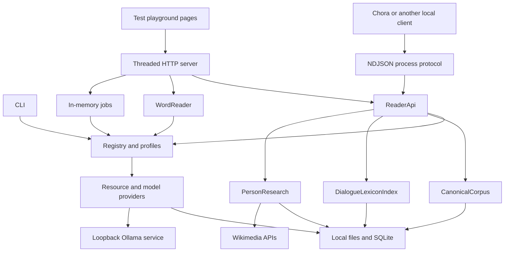

# PlatoSI — Architecture, Implementation, and Development Reference

This guide explains the implementation reviewed on **4 November 2026** and how to configure, maintain, test, extend, and integrate it. [README.md](README.md) describes user capabilities and workflows. [CODEBASE_AUDIT.md](CODEBASE_AUDIT.md) remains the comprehensive source-backed inventory, including confirmed gaps, inferred risks, and verification boundaries. Historical test and installation observations below refer to that audit; the documentation reorganization did not rerun the application suite.

## System architecture

PlatoSI was built as Chora's text and linguistic service. Chora owns the reader-facing workspace, Dreams, Signals and reader observations; PlatoSI supplies canonical text, exact locations, linguistic evidence and optional research synthesis. The local process API is the integration path used by Chora. The CLI and threaded HTTP playground support independent inspection and testing; the playground reader is not the primary product interface.

The implementation is a Python source-tree package. Core text retrieval and serving use the standard library. Dilemma is an optional third-party Python dependency; Ollama is an optional external local HTTP service. Personal-name research additionally uses online Wikimedia JSON services.

The backend separates resource selection from provider implementations. A registry discovers plugin manifests, merges local overrides, and lazily loads providers. Retrieval services call advertised capabilities and retain source attribution. Canonical dialogue text is a separate service with its own inventory and versioned location contract; it does not depend on the provider registry for its basic operations.



The test playground's edition/scope reader and the canonical API used by Chora use distinct representations and offsets. A consuming client must choose the correct contract rather than treating all passage records as interchangeable. Limits of the test playground's controls do not describe Chora's interface.

### Chora integration

The adjacent Chora repository's `PlatoSiGateway` calls `canonical.catalog`, `canonical.work`, `linguistics.dialogue-lexicon` and `linguistics.person-research`. Its word pane presents dialogue-wide occurrences, related lemmas and name research. Chora persists lemma observations by dialogue/text version/lemma through its own observation repository, separately from PlatoSI caches. These integration paths were source-reviewed while preparing the [Chora user guide](../Chora/README.md); Chora was not launched for that documentation change.

Chora starts the process service itself. Running `scripts/playground.py` is not a prerequisite for Chora, and the standalone conversation and Dilemma laboratory should not be described as Chora screens.

## Repository structure

| Location | Responsibility and useful starting points |
| --- | --- |
| [src/platosi/](src/platosi/) | Application services and shared infrastructure |
| [plugins/](plugins/) | Five manifest/provider pairs: Perseus, LSJ/Logeion, GLEM, Dilemma, Ollama |
| [playground/](playground/) | Test interfaces: five HTML files, four JavaScript files, shared CSS; no build step |
| [scripts/](scripts/) | Launchers, source acquisition/validation, canonical building, dependency checking, packaging |
| [tests/](tests/) | Twelve Python test modules, an independent JavaScript contract check, shared fixture |
| [docs/](docs/) | Pinned inventories, generated validation reports, contract documentation, research and plans |
| `data/` | Downloaded sources, local overrides/preferences, canonical works, indexes and caches; mostly ignored by Git |
| `dist/` | Generated portable archives and checksums; ignored by Git |

The package version is `0.1.0.dev1` in [__init__.py](src/platosi/__init__.py). There is no root `pyproject.toml`, `setup.py`, dependency requirements/lockfile, frontend package manifest, CI workflow directory, or application `LICENSE` in the reviewed checkout. Launchers add `<root>/src` to `sys.path`; the source tree is directly runnable.

### Major modules

| Component | Relevant symbols |
| --- | --- |
| [registry.py](src/platosi/registry.py) | `Registry`, `RegisteredProvider.load`: discovery, config, activation, lazy loading |
| [profiles.py](src/platosi/profiles.py) | `Profiles`, `select`: persisted ordered preferences and per-request selection |
| [contracts.py](src/platosi/contracts.py) | Typing protocols for corpus, reading, dictionary, morphology, scholarly and model providers |
| [storage.py](src/platosi/storage.py) | `new_index`, `read_index`, `signature`, `stamp`, `current`, `verify_blob` |
| [unicode_search.py](src/platosi/unicode_search.py) | `normalize`, `key`, `matches`: explicit normalization and offset mapping |
| [cli.py](src/platosi/cli.py) | `main`, `print_inquiry`: commands and output |
| [playground.py](src/platosi/playground.py) | `Playground`, `Server`, `Handler`, `serve`: HTTP, discovery and background jobs |
| [reader_api.py](src/platosi/reader_api.py) | `ReaderApi.execute`: shared operation dispatcher and organized evidence |
| [reader_protocol.py](src/platosi/reader_protocol.py) | `serve`: versioned process envelopes, workers, limits and cancellation |
| [word_reader.py](src/platosi/word_reader.py) | `WordReader`, `tokens`, `occurrence`: indexed scope exploration and occurrences |
| [canonical_build.py](src/platosi/canonical_build.py) | `Collector`, `extract_segments`: deterministic TEI extraction |
| [canonical_text.py](src/platosi/canonical_text.py) | `CanonicalCorpus`, `make_work`, `text_version`, `python_offset`: canonical validation and locations |
| [dialogue_lexicon.py](src/platosi/dialogue_lexicon.py) | `DialogueLexiconIndex`: canonical tokens, form/relation caches and joins |
| [inquiry.py](src/platosi/inquiry.py) | `inquire`, `model_provider`, `evidence_record`: selected evidence and model generation |
| [word_models.py](src/platosi/word_models.py) | `Examination`, `evidence_package`, `parse_assessment`, `compare`: two-model word assessment |
| [person_research.py](src/platosi/person_research.py) | `PersonResearch`, `PersonResearchCache`: references, lexical comparisons, summaries and caches |
| [cancellation.py](src/platosi/cancellation.py) | `Cancellation`, `Cancelled`: cooperative event-based cancellation |

## Entry points and runtime lifecycle

| Entry point | Behavior |
| --- | --- |
| `python scripts/platosi.py [--root PATH] COMMAND` | Calls `cli.main`; profile operations use `Profiles`, other commands normally construct a registry. Most output is JSON; inquiry is readable by default unless `--json` is passed. |
| `python scripts/playground.py [--port 8765] [--lan]` | Creates `Playground` and `ThreadingHTTPServer`; serves pages/JSON and starts in-memory daemon jobs. Root is derived from the script, not a `--root` option. |
| `python -u scripts/reader_api.py` | Runs `reader_protocol.serve` over binary stdin/stdout; no network listener. Root is derived from the script. |
| `python scripts/build-canonical-corpus.py [--dialogue ID]` | Acquires missing pinned canonical sources and verifies/builds work JSON. |
| `python scripts/check-local-dependency.py` | Launches an isolated child service, checks identity/catalogue, resolves the Republic opening word, closes and checks the process. |
| `python scripts/package-platosi.py --output PATH` | Builds a portable ZIP, manifest and SHA-256 sidecar without publishing it. |

The process server shares a `ReaderApi` instance across four executor workers. `ReaderApi.execute` creates a fresh registry for most operations, but skips registry initialization for `canonical.*` and `system.info`. Canonical operations can therefore work despite unrelated plugin failures. Capability discovery does inspect resources and is a separate readiness request.

## Setup and configuration

### Runtime prerequisites

Python 3.10+ syntax is used; the audit exercised **Python 3.12.10** on Windows. Core services require no third-party Python packages. Use the interpreter that owns any optional dependencies. Node is needed only for JavaScript checks, not to serve the playground. PowerShell runs the supplied indexed-source acquisition and validation scripts.

Run commands from the project root. If `python` is unavailable on `PATH`, use the interpreter's absolute path. No application installer or dependency lockfile provisions all optional services.

### Indexed test-tool and CLI dictionary setup

```powershell
powershell -NoProfile -ExecutionPolicy Bypass -File .\scripts\download-plato.ps1
python .\scripts\platosi.py index perseus-plato
powershell -NoProfile -ExecutionPolicy Bypass -File .\scripts\download-lsj.ps1
python .\scripts\platosi.py index lsj-logeion
python .\scripts\platosi.py status
python .\scripts\playground.py
```

The downloaders verify pinned Git blobs, write inventories, and run validators that update reports under `docs/`. Provider indexes are built separately. The indexed corpus supports CLI/test tools; the LSJ index is also used by Chora's canonical word workflow. The last command launches the optional test playground, not Chora. These commands mutate sources/indexes/reports and should not be presented as read-only checks. During the audit, commands were inspected and existing source bytes verified; internet acquisition was not repeated.

### Canonical corpus setup

```powershell
python .\scripts\build-canonical-corpus.py
python .\scripts\check-local-dependency.py
```

This provisions Chora's text dependency and is independent of `index perseus-plato`. It does not provision the test playground's older indexed reader. `--dialogue republic` builds one canonical work, while catalogue discovery and the dependency check require the full set of work files. The builder reads existing source files, rejects hash mismatches, downloads absent files, and writes verified works atomically per file. It is not a transaction over the whole corpus.

### Provider overrides

`data/plugin-config.json` maps provider IDs to optional `enabled` and `config` values. Config shallow-merges with the manifest; relative paths resolve from the project root and absolute paths are also supported. For example, this illustrates configuring a separately provisioned Dilemma installation:

```json
{
  "dilemma": {
    "enabled": true,
    "config": {
      "data": "D:\\Greek\\dilemma\\data",
      "model": "D:\\Greek\\dilemma\\model",
      "tagger": "D:\\Greek\\dilemma\\tagger",
      "paradigm_data": "D:\\Greek\\dilemma\\data"
    }
  }
}
```

These example directories must already contain the appropriate artifacts. CLI `enable ID` / `disable ID` updates activation in the same file. Changing paths/configuration of indexed providers changes their manifest signature and requires rebuilding their index. Changing the actual source revision requires accurate matching inventory and provenance, not just pointing a pinned manifest at unrelated data.

### Optional morphology

GLEM defaults to disabled. Acquisition downloads research files for both GLEM and the Euthyphro treebank, but only GLEM's merged mapping list has a runtime provider:

```powershell
powershell -NoProfile -ExecutionPolicy Bypass -File .\scripts\download-morphology.ps1
python .\scripts\platosi.py enable glem
python .\scripts\platosi.py index glem
```

The manifest records unresolved data licensing. See [the recorded GLEM review](docs/glem-licensing-review.md); local enablement is not redistribution clearance.

Dilemma expects `dilemma-nlp` **1.3.12** in the selected interpreter and configured artifact directories. Defaults are under `data/dilemma/`. Its base availability check requires `lookup.db` and the exact package version; other operations need additional files. The repository does not provide a Dilemma artifact downloader or a complete reproducible installation recipe. Restart after changing directories: configuration uses process-wide environment variables and an already imported Dilemma with another data directory is rejected.

At audit time the external local installation was available, but `lsj_headwords.json`, `cunliffe_headwords.json`, and `lemma_equivalences.json` were absent. Headword/repair/strict-citation readiness must be checked separately. That machine's absolute session paths are local overrides, not portable defaults.

### Optional local models

Install/run Ollama and acquire models separately. [The manifest](plugins/ollama/plugin.json) defaults to `http://127.0.0.1:11434`, model `qwen3.5:9b`, `think=false`, temperature 0.2 and `num_predict=500`. PlatoSI does not pull or train models.

```powershell
python .\scripts\platosi.py models
```

Use a discovered local name via CLI `--model`, browser selection, or configured default. A reachable Ollama service does not guarantee that the configured default model is installed. The adapter filters explicit remote/cloud declarations and only accepts HTTP loopback origins.

### Profiles and resource selection

```powershell
python .\scripts\platosi.py profile save reader --resource perseus-plato --resource lsj-logeion
python .\scripts\platosi.py profile list
python .\scripts\platosi.py profile show reader
python .\scripts\platosi.py profile save text-only --text-first --resource perseus-plato
```

`Profiles.save` replaces the complete named profile, validates its exact `{resources,text_first}` shape, and atomically replaces `data/reader-profiles.json`. IDs need not be installed. There is no profile-delete command or browser profile editor.

`select` preserves resource order. A nonempty explicit include list replaces profile selection; exclude removes IDs. Text-first suppresses non-corpus resources unless explicitly included. Missing, disabled, unavailable and unsupported resources are reported; selection never enables a disabled provider. `WordReader` treats an explicit empty include list as selecting nothing, unlike ordinary `select`, where it means no override.

### Local network mode

```powershell
python .\scripts\playground.py --lan
```

LAN mode binds `0.0.0.0`, prints detected private IPv4 URLs and a per-process token, and requires form login. Use the numeric-IP URL: `localhost` is not in the HTTP host allowlist. The default mode binds `127.0.0.1`.

`Server` / `Handler` validate host/client addresses and matching POST Origin, issue HttpOnly/SameSite=Strict cookies, and send no-store, nosniff and CSP headers. HTTP is unencrypted. Sessions are shared server-memory access tokens without accounts, expiry or logout; there is no TLS or automatic firewall configuration. These controls are not a deployment design for public hosting.

## Plugin architecture and provider lifecycle

`Registry` scans sorted `plugins/*/plugin.json`. Required fields are `id`, `type`, `version`, `module`, `capabilities`, `source`, and `license`; duplicate IDs are rejected. `enabled_by_default` and `config` are optional. Local overrides determine effective config and activation.

`RegisteredProvider.load` imports the named Python module with `importlib`, calls `create_provider(manifest, root)`, and caches the instance under a lock. `available()` determines base readiness; operation selection also checks activation and advertised capabilities. Provider files are trusted executable code, not sandboxed extensions.

Provider lifetime differs by entry point:

| Caller | Lifetime / refresh behavior |
| --- | --- |
| CLI | Registry normally lives for one invocation |
| `ReaderApi.execute` | Fresh registry for each resource operation |
| `WordReader._registry` | Reuses registry until manifest/config size or modification time changes |
| `Playground._dilemma_registry` | Reuses registry without a manifest/config refresh check |

`contracts.py` defines typing protocols, not runtime validation. Newer capabilities such as `match_forms`, `lemma_forms`, `lemma_relations`, and `evaluate` are implemented by convention without a complete matching set of protocols. `ScholarlyResourceProvider.retrieve`, CLI `retrieve`, and inquiry `--scholarly-query` are real extension plumbing, but no shipped provider advertises `retrieve`.

### Supplied providers

| Provider | Type / capabilities | Default activation and dependencies |
| --- | --- | --- |
| [perseus-plato](plugins/perseus-plato/provider.py) | Corpus: `search`, `passage`, `reading` | Enabled; downloaded source directory and current index |
| [lsj-logeion](plugins/lsj-logeion/provider.py) | Dictionary: `lookup`, `lemma_relations` | Enabled; LSJ XML and current index |
| [glem](plugins/glem/provider.py) | Morphology: `analyze`, `match_forms`, `lemma_forms` | Disabled; merged mapping list and current index |
| [dilemma](plugins/dilemma/provider.py) | Morphology: `analyze`, `match_forms`, `lemma_forms`, `evaluate` | Disabled; exact Python package and external artifacts |
| [ollama](plugins/ollama/provider.py) | Language model: `models`, `generate`, `chat` | Enabled; local Ollama and installed model |

Manifest defaults differ from local overrides. In the audited installation Dilemma was enabled and GLEM disabled. Provider status is not a guarantee that every advertised operation has all prerequisites.

## Corpus representations and text locations

### Indexed Perseus editions

`PlatoProvider.build` indexes Greek edition XML from revision `a6eb0cc3e6f6e382934a2c8b33577d2fb4371e00`. `extract` concatenates TEI body descendant text without inventing separators, records hierarchical textpart divisions, Stephanus milestones and selected editorial spans, and preserves citation declarations. The audited local index contained 36 editions.

The index stores raw text, normalized search keys, divisions, milestones, markup and source metadata. `search` uses SQLite `instr` to identify candidate editions, then checks explicit Unicode boundaries and maps matches back to original text. It does not use FTS5.

`passage` first matches a dot-joined textpart path such as `1.327`, then tries a Stephanus section such as `327a`. `record` can return surrounding textpart context in `text`; `match`, `match_start` and `match_end` identify the actual span. `reading` accepts a division and returns scope text, initial citation, scope-relative milestones and markup. It is not a general CTS resolver.

Raw body extraction includes labels, bibliographic material and editorial additions/deletions. Recognized tags are `del`, `add`, `label`, `bibl`, `sic`, `corr`, `head`, and `gap`. Search overlap can produce `editorial_text`; passage classification does not apply the same search-mode rule. Retain markup and inspect original XML when interpreting evidence.

### Canonical dialogue text

The canonical inventory [canonical-corpus-v1-inventory.json](docs/canonical-corpus-v1-inventory.json) independently pins revision `9a424880e535b7b24258feda413fa37580f8971f` and a frozen 35-work baseline. It is implemented through `canonical_build.extract_segments`, `canonical_text.make_work`, and `CanonicalCorpus`.

Extraction walks `p`, `sp`, and `lg` blocks, flushes at section/paragraph boundaries, collapses source whitespace, preserves explicit and verse line breaks, normalizes NFC, and records quotation/citation annotations. Contiguous segments sharing a reference form one section, joined by LF. Books are recorded where available; otherwise chapter `1` is assigned. Reappearing noncontiguous references and inconsistent divisions are rejected.

`segment_digest` verifies segments, annotations and divisions. `text_version` fingerprints location-addressable text and reference order. `CanonicalCorpus.work` reconstructs and compares the stored object before returning it. Catalogue readiness checks all expected files exist; individual work loading performs integrity verification. Partial installations can serve known works even when catalogue discovery is unavailable.

Supported canonical dialogue IDs:

```text
euthyphro, apology, crito, phaedo, cratylus, theaetetus, sophist,
statesman, parmenides, philebus, symposium, phaedrus, alcibiades-1,
alcibiades-2, hipparchus, lovers, theages, charmides, laches, lysis,
euthydemus, protagoras, gorgias, meno, greater-hippias, lesser-hippias,
ion, menexenus, cleitophon, republic, timaeus, critias, minos, laws,
epinomis
```

The audited corpus contained 8,261 sections. This is a supported collection, not a scholarly attribution judgement. There is no multi-version snapshot archive or automatic migration of saved anchors.

### Unicode and offset rules

| Context | Coordinate / matching rule |
| --- | --- |
| Indexed `text`, reading tokens and word positions | Python Unicode code-point offsets into the returned context or scope; end-exclusive |
| Browser indexed reader rendering | `Array.from(text)` bridges the returned code-point offsets to DOM token construction |
| Canonical locations | Zero-based UTF-16 code units within a Stephanus section; start-inclusive/end-exclusive |
| Canonical annotations | UTF-16 offsets within the individual segment |
| Exact search keys | Canonical composition equivalence and whitespace collapse, preserving case and accents |
| Accent-insensitive keys | Also remove combining marks, including breathings/iota subscript; preserve case |

`unicode_search.normalize` returns both normalized text and a map to original ranges. `matches` checks boundaries using Unicode letters, marks, numbers and underscore. Neither mode stems words or performs semantic search, and normalized keys do not replace returned original text.

The canonical location object contains exactly these fields:

```json
{
  "dialogue": "republic",
  "text_version": "sha256:0d5d71f80d42eee6ec5c5328d1d1926789ddb327f53c8787131b1a20aa4af5ef",
  "start": {"stephanus": "327a", "offset": 0},
  "end": {"stephanus": "327a", "offset": 7}
}
```

The example identifies the audited Republic baseline and selects `κατέβην`; obtain the installed version from catalogue/work responses in client code. Persist it with every location. `python_offset` converts UTF-16 boundaries explicitly and rejects offsets splitting a surrogate pair. Empty ranges are valid; reversed ranges, unknown sections and unavailable versions are errors. Cross-section selections follow stored section order and join with LF; returned context contains boundary sections.

The fingerprint is SHA-256 over length-prefixed UTF-8 contract ID, dialogue ID, section count and ordered reference/text values. It does not cover titles, annotations or division labels; the separate segment baseline check covers additional structure. See [the complete location contract](docs/text-location-contract.md) and [shared conformance fixture](tests/fixtures/text-location-v1.json). Do not silently reinterpret indexed offsets or substitute another revision when resolving a canonical location.

## Dictionary and morphology implementation

### LSJ / Logeion

`LSJProvider.build` indexes `./text/div1/div2` entries from local `greatscott*.xml`. The compound key is source file plus ordinal, so duplicate upstream IDs remain separate. Records retain headword, original attributes, parsed/reserialized XML and provenance.

`lookup` returns complete normalized headword matches first, then explicit direct-child `orth` aliases up to the limit. Alias extraction removes internal hyphens but excludes incomplete leading/trailing-hyphen fragments. `lemma_relations` only emits directed `etymological_relation` records when a Greek `etym` target is a valid whole headword present in the index. It retains the source entry identity and exact XML fragment.

The audited index contained 117,168 entries and 9,025 aliases. It represents the downloaded LSJ collection, not every dictionary on the Logeion website. `ReaderApi.organize_dictionary_entry` optionally derives plain text; the browser separately extracts readable excerpts from XML.

### GLEM

`GlemProvider` indexes one merged three-column list into form/lemma/raw-tag rows identified by source line. It supports exact/accent-insensitive analysis, direct requested-form matching, and reverse lemma-form inventories. It provides no context-sensitive disambiguation or per-row PROIEL-versus-Perseus provenance. The audited index had 377,255 rows.

The other acquired GLEM files and AGDT Euthyphro contextual annotations support research/validation, not additional runtime providers. Keep that distinction when exposing new capabilities.

### Dilemma

`DilemmaProvider.analyze` accepts exact NFC input and serializes work on one executor thread. `_analyze` calls verbose lemmatization with `guess=False`, `skip_pos=True`, and both article-resolution settings. Records retain source method, settings and lookup-versus-rule classification. A no-neural-guess path can still produce rule-generated suggestions.

`match_forms` and `lemma_forms` query direct lookup rows separately for Greek/all languages. They do not silently turn generated paradigms into canonical occurrences. Engines and taggers are cached by settings; CPU/Greek are fixed. Directory environment variables are process-wide and checked for conflicts.

The 18 laboratory feature IDs are `analyze`, `batch`, `predict_pos`, `attestation`, `spelling`, `headwords`, `repair`, `tagger`, `paradigm`, `generate`, `morphology_diff`, `reconcile`, `normalization`, `nonlexical`, `citation`, `lookup`, `cache`, and `inventory`. `_evaluate` dispatches these to upstream operations, reports elapsed time, and converts dataclasses/enums/paths to JSON-compatible values. [The audit's laboratory inventory](CODEBASE_AUDIT.md#4-dilemma-laboratory-inventory) records each call and prerequisite.

Artifact metadata fingerprints relative names, sizes and modification times, not file content. `revision_verified` is explicitly false. Base availability only checks lookup data/package version, so do not present it as full laboratory readiness.

## Canonical evidence and dialogue lexicons

`ReaderApi.canonical_word_evidence` accepts exactly a `location` selecting one Greek word without punctuation. It resolves canonical text, calls basic analysis/dictionary collection, groups candidates by lemma, and organizes dictionary entries. `linguistic_evidence` optionally adds Dilemma normalization, spelling suggestions, attestation and paradigms; failure can yield partial evidence/warnings.

`linguistics.dialogue-lexicon` uses the same word evidence, loads bounded reverse form inventories and explicit lexical relations, then intersects direct mappings with canonical dialogue tokens. Returned forms include counts, canonical locations, divisions, passages and mapping evidence. Related lemmas remain distinct from inflections and are sorted with dialogue-present targets first.

`DialogueLexiconIndex` stores tokens once per dialogue/text version/policy and keeps provider form and relation caches separately. Provider fingerprints cover manifest/source/config metadata and optional artifact metadata. Ready entries are reused across selected forms of the same lemma. Supplied relation extraction is limited to LSJ etymology targets; accepted relation vocabulary is broader, and Dilemma does not advertise `lemma_relations`.

Important maintenance limits: canonical candidate projection reads nested `analysis.tag`, losing GLEM's top-level tag; deduplication excludes settings. Provider failures can be caught and cached as ready partial/empty inventories. Concurrent first requests lack a shared per-identity work lock. These are audited limitations, not promised behavior to extend uncritically.

## Model and personal-name research pipelines

### Grounded inquiry

`inquiry.inquire` gathers selected resource records, assigns evidence IDs, and requires some corpus evidence before generating. Passage input is bounded to the provider's exact match through `evidence_record`; search evidence is labelled as surrounding textpart. Prompts ask the model to preserve uncertainty and cite evidence. Output checks detect unknown/missing IDs and generation limits, not factual entailment.

Selection differs by interface:

| Path | Evidence/model selection |
| --- | --- |
| CLI/browser grounded inquiry | Corpus-only by default without profile/include; explicit terms or Greek words in question/search text drive dictionary/morphology queries |
| Home/API word analysis | Queries supplied form and expands returned candidate lemmas into dictionary lookups |
| Process `inquiry.ask` | Automatically considers non-model resources and requires the sole enabled chat provider; no payload model/profile selector |
| Canonical-location `inquiry.ask` | Resolves canonical text, then searches that text in the independently pinned edition index |

The last path does not verify canonical/indexed revision equivalence. Dictionary/morphology records in ordinary `inquire` are not automatically expanded through returned lemmas. Generic scholarly retrieval only runs when a scholarly query is explicitly supplied, and no shipped provider supplies it.

### Ollama transport and two-model assessments

`OllamaProvider` uses `/api/tags`, non-streamed `/api/generate`, and streamed `/api/chat`. Chat handles HTTP framing, split Unicode and NDJSON, checks cancellation during waits, and closes the socket. Browsers receive a completed job result rather than token streaming. Only explicit remote/cloud metadata is filtered; local discovery is the adapter's available model boundary.

`Examination.run` sends the same evidence independently and sequentially to primary/validation models. `parse_assessment` validates candidate identities, allowed statuses, reasons, evidence IDs and completeness. The validator does not see the primary response. Same-model selections are allowed with a warning.

`evidence_package` truncates each long dictionary XML at 8,000 characters with a flag and rejects packages exceeding 100,000 UTF-8 bytes. Cache identity covers evidence/prompts, provider identity/config digest, model digest and generation settings. Only successful results with both model digests are reusable; `fresh` bypasses a hit. Semantic accuracy remains unverified.

### Personal-name research

`ReaderApi.person_research` requires location+lemma, confirms that lemma is an analysis candidate, and requires a nested `proper=True` candidate. This is a capitalized-headword gate, not contextual named-entity recognition. It uses the sole enabled chat provider's configured model.

`PersonResearch.online_sources` queries Wikidata search, English Wikipedia search/intros, and an exact English Wiktionary title. Each URL response is cached; fetch timeout is 15 seconds and source excerpts are capped at 3,000 characters. Source organization deduplicates provider/URL and tags relevance but preserves retrieval order.

`root_sources` combines model search proposals with a limited deterministic name-ending candidate, requires shared stem and dictionary hits, and stops after its first accepted lexical comparison. `summarize` requests JSON, filters sentences/relationships with invalid or absent source IDs, and labels unsupported derivation as a possible comparison. It does not verify identity or source entailment.

Context is passed into the service and included in summary cache identity, but is currently absent from both model prompts. JSON response schemas are sent to the model, while local validation does not fully enforce all field types/bounds. Web cache has no TTL, root cache omits model identity, and requests have limited cancellation during fetches. Consult the audit before relying on stronger grounding or invalidation guarantees.

## API operations and integration contracts

### Local process protocol

Start `python -u scripts/reader_api.py` as a child process and exchange one UTF-8 JSON object per newline. Reserve stdout for protocol messages and consume stderr separately. `-I` can isolate Python from user-site/environment configuration, but optional providers must remain installed in the chosen interpreter environment.

Start with this readiness request:

```json
{"version":1,"id":"hello","operation":"system.info","payload":{}}
```

An `ok` envelope returns `service`, application `version`, `protocol_version`, and `location_contract`. Check these before dependent work. Then request `capabilities` and, for canonical text, `canonical.catalog` / `canonical.work`. Take versions from installed responses, not a hardcoded example.

| Operation | Payload and result purpose |
| --- | --- |
| `system.info` | Empty object only; service/version identity |
| `capabilities` | Object; operation availability, component parts and issues |
| `word.analyze` | `form` ≤200 characters; morphology/dictionary result sections |
| `linguistics.evidence` | Exactly `location`; organized canonical word evidence |
| `linguistics.dialogue-lexicon` | Exactly `location`; dialogue forms/counts/locations and related lemmas |
| `linguistics.person-research` | Exactly `location`, `lemma` ≤200; candidate gate, references and summary |
| `lemma.matchForms` | `lemma` plus 1–500 distinct nonempty `forms`, each ≤200 characters; direct mapping evidence |
| `dilemma.evaluate` | `feature` and object `options`; laboratory response/status |
| `text.search` | `text` ≤4,000; exact indexed search, 20 records per provider |
| `text.passage` | `edition` ≤500 and `citation` ≤100; indexed passage records |
| `inquiry.ask` | `question` ≤4,000 plus location, text ≤4,000, or edition+ citation; grounded answer/evidence |
| `canonical.catalog` | Object; complete installed catalogue, requires all expected work files |
| `canonical.work` | `dialogue`, optional `text_version`, optional exact `{type,label}` division; verified work |
| `canonical.resolve` | Exactly `location`; exact selected text/source/boundary context |
| `request.cancel` | New request ID; payload contains different target `id`; cooperative cancellation acknowledgement |

Canonical locations use the object defined above. For example, a division request is:

```json
{"version":1,"id":"book","operation":"canonical.work","payload":{"dialogue":"republic","division":{"type":"book","label":"1"}}}
```

Active IDs must be nonempty strings of at most 128 characters and unique among pending requests. Responses may arrive out of order. Terminal envelope statuses are `ok`, `invalid`, `failed`, and `cancelled`; an `ok` envelope can contain an operation-level `partial`, `unavailable`, or `failed` status. Payload extra-field strictness varies by operation.

Messages are limited to 2,000,000 bytes, responses to 8,000,000 bytes, and pending requests to 16; four workers run operations. Cancellation acknowledgement reports whether the target was pending and does not replace its terminal response. EOF requests cancellation and waits for workers. Non-cooperative work can delay exit.

There is no process operation for model listing/selection, profile mutation, provider activation, indexing, note storage or generic scholarly retrieval. Use CLI/browser controls where implemented. The [local dependency guide](docs/local-dependency.md) provides further installation/lifecycle context; the audit describes interface gaps.

### Test playground: browser/server architecture and HTTP routes

This section describes PlatoSI's test harness, not Chora's Electron UI. `playground.Handler` serves fixed files and routes; no client framework or router is involved. `lookup.js`, `reader.js`, `app.js`, and `dilemma.js` own their page state and call `fetch`. DOM/text nodes render output; dictionary XML is parsed for text excerpts, not injected as executable HTML. Conversation supports limited inline formatting, not full Markdown.

| Method / route | Purpose |
| --- | --- |
| `GET /`, `/reader`, `/conversation`, `/dilemma` | Lookup, indexed reading, conversation and laboratory pages; root becomes login when unauthenticated in LAN mode |
| `GET /lookup.js`, `/reader.js`, `/app.js`, `/dilemma.js`, `/style.css` | Fixed static assets |
| `GET /api/bootstrap` | Chat models, prompts, profile names and non-model resource metadata |
| `GET /api/reader/options` | Profiles and provider metadata without config; no availability probe |
| `GET /api/lookups` | Full capability discovery, including API-only operations |
| `GET /api/dilemma` | Laboratory catalogue, provider/artifact/readiness metadata |
| `GET /api/jobs/<id>` | Job status/result/error |
| `POST /login` | LAN token form; session cookie and redirect |
| `POST /api/lookup` | Only `word.analyze`, `text.search`, `text.passage` |
| `POST /api/reader/scope` | Indexed scope and token positions |
| `POST /api/reader/explore` | Selected-word local evidence |
| `POST /api/reader/occurrences` | Candidate lemma occurrences within scope |
| `POST /api/reader/examine` | Two-model assessment job |
| `POST /api/jobs` | Free/grounded conversation job |
| `POST /api/dilemma/jobs` | Laboratory job |
| `POST /api/jobs/<id>/stop` | Stop signal and immediate cancelled state |

HTTP is not a general mirror of `ReaderApi.execute`: canonical/linguistics operations and process `inquiry.ask` have no corresponding bundled HTTP endpoint. GET host/client checks apply; POST also requires matching Origin. LAN authentication gates all but login/root login page/stylesheet. JSON body size is 1–2,000,000 bytes; login form size is 1–4,096 bytes.

`Playground` creates random-ID daemon jobs and locks status/result updates. Running jobs are retained; completed jobs are pruned on later submissions using creation-time cutoffs of 300 seconds for conversation/examination and 1,800 seconds for lab submissions. HTTP has no global job queue cap or response-size limit. Job memory is shared across authenticated users, without per-user ownership.

`stop` marks a running job cancelled and signals its token. Dilemma's underlying evaluation receives no token; the reader has no examination stop control and changing selection can leave the old computation running. A failed Dilemma operation can be nested in a completed job because evaluation errors become result data. Clients should inspect both levels of status.

## Persistence and index maintenance

| Store | Contents / identity |
| --- | --- |
| `data/plugin-config.json` | Effective enablement/config overrides; written directly by `Registry.set_enabled` |
| `data/reader-profiles.json` | Ordered resources/text-first; atomic file replacement by `Profiles.save` |
| `data/tlg0059/`, `data/upstream/` | Indexed Perseus sources and upstream metadata |
| `data/lsj-logeion/`, `data/greek-morphology/` | Downloaded dictionary/research inputs |
| `data/indexes/perseus-plato.sqlite` | `index_metadata`; `editions` with URN, source, text, normalized keys, structural/markup JSON |
| `data/indexes/lsj-logeion.sqlite` | `index_metadata`; `entries` keyed by file/ordinal; `aliases` with classification/fragment |
| `data/indexes/glem.sqlite` | `index_metadata`; source-line `mappings` of form/lemma/tag and keys |
| `data/canonical-text-v1/` | Pinned source XML/metadata and verified `works/<dialogue>.json` |
| `data/dialogue-lexicon-v1.sqlite` | Schema 2: token `index_builds`/`tokens`, `lemma_builds`/`lemma_forms`, `relation_builds`/`lemma_relations`, schema metadata |
| `data/word-exploration-cache.sqlite` | `examinations(key,result)`; evidence/model-identity/settings-derived cache |
| `data/person-research-cache-v1.sqlite` | URL-keyed `web_cache` and policy/input-keyed `model_cache`, timestamps |
| Browser localStorage | `platosi-note:<JSON [provider,edition,scope,start]>` and `:lemma`; no canonical version key |

Conversation/laboratory histories, server jobs and LAN sessions are in memory. Notes are browser-origin/device-specific, have no synchronization/export, and are not sent to models. Backend caches are not a user notebook. [.gitignore](.gitignore) excludes downloaded corpora, indexes, caches, settings, distributions, and common model-weight formats.

Provider `build` methods verify selected pinned source sets, sizes, revisions and Git blob hashes. `storage.new_index` writes a temporary SQLite file and replaces the old one after successful completion; failed builds preserve old indexes. `read_index` opens `mode=ro`. The signature covers ID/version/source/config, not current source bytes, so post-build source edits are not automatically detected.

Dialogue caches key builds by canonical version, policy and provider fingerprints. Schema 1→2 is handled; incompatible schema versions are rejected. There is no general cleanup/version-retention management command. Web research has no TTL/refresh control, and metadata-derived fingerprints do not provide content-hash invalidation. Avoid assuming cache reuse proves data is current or complete.

## CLI reference

The parser in `cli.main` is the authoritative option reference. Global `--root PATH` precedes the command. Supported commands are `status`, `enable`, `disable`, `index`, `profile list/show/save`, `search`, `lookup`, `analyze`, `passage`, `retrieve`, `models`, and `inquire`.

```powershell
python .\scripts\platosi.py search "κατέβην" --profile reader --limit 20
python .\scripts\platosi.py search "κατεβην" --mode accent-insensitive
python .\scripts\platosi.py lookup "καταβαίνω"
python .\scripts\platosi.py analyze "κατέβην" --include dilemma
python .\scripts\platosi.py passage "urn:cts:greekLit:tlg0059.tlg030.perseus-grc2" "327a"
python .\scripts\platosi.py inquire "Discuss the opening" --edition "urn:cts:greekLit:tlg0059.tlg030.perseus-grc2" --citation "327a" --provider ollama --model "qwen3.5:9b" --json
```

Retrieval/inquiry commands accept `--profile`, repeated `--include` and `--exclude`. Applicable search/lookup/analyze limits are per provider. `inquire` additionally supports explicit text, repeatable headwords/forms, scholarly JSON query, generation JSON, provider/model and evidence limit. Indexing requires enabled providers with `build`; Dilemma and Ollama do not have builders. Generic `retrieve` requires an added scholarly provider.

## Extending and maintaining the application

### Adding a provider

1. Create a plugin directory with a unique manifest ID and required metadata. Advertise only implemented capabilities, and state source revision, attribution and licensing accurately.
2. Export `create_provider(manifest, root)` from the configured module. Return an object implementing `available` and the advertised methods with the same signatures used by existing callers.
3. Keep lookup data local to that provider. For an indexed resource, use temporary/atomic builds and accurate metadata signatures; expose source identities and uncertainty in JSON-compatible records.
4. Add fixture-based tests for selection, unavailable sources, limits, failure isolation, source attribution and actual record semantics. The retrieval/profile tests demonstrate independent test providers.
5. If adding a new capability, update its consumers and typing contracts as needed. Capability advertisement alone does not create a CLI command, process operation, browser endpoint or UI.

Existing records distinguish primary/editorial text, scholarly dictionary classifications, candidate analyses, lexical relations and model output. Preserve those distinctions; do not label generated forms as observed occurrences until they are located in the authoritative corpus.

### Adding an API or UI feature

An operation needs dispatcher implementation in `ReaderApi.execute`, payload validation, capability/readiness reporting where applicable, and tests of its result/error contract. Ensure the process envelope and operation-level status remain distinguishable. Check cancellation boundaries and avoid unsolicited stdout from providers that would corrupt NDJSON.

A browser feature separately needs an allowed `Handler` route, page controls and JavaScript requests/rendering. Existing API-only functionality is not accessible through arbitrary HTTP requests. Use the page's stale-response guards and safe text rendering; handle missing providers and partial evidence. If adding controls, the markup tests compare referenced element IDs with HTML.

### Changing text or matching policy

Treat canonical extraction, source pin, segmentation, annotations, fingerprints and persisted locations as a compatibility boundary. Update inventories deliberately and run shared Python/JavaScript conformance checks. Do not change code-point/UTF-16 semantics in place or relocate an old anchor by a similar-text guess.

When changing lexical evidence, review cache identities and policy versions. Empty/partial results currently can become ready cached inventories after provider errors, and concurrent first-request serialization is incomplete. A cache/schema change requires explicit compatibility tests, not merely a successful lookup.

Chora's graph, annotations and migrations belong to another repository. PlatoSI exposes text/evidence contracts but does not implement or verify that application's reader behavior. Plans under `docs/` must be checked against code before being described as completed features.

## Testing and validation

### Existing checks

```powershell
python -B -m unittest discover -s tests -v
node tests\text_location_contract.mjs
node --check playground\app.js
node --check playground\reader.js
node --check playground\lookup.js
node --check playground\dilemma.js
```

For inherited Python subprocesses, `PYTHONDONTWRITEBYTECODE=1` can suppress bytecode writes; isolated `-I` processes ignore Python environment variables. The clean-install tests build/extract into temporary directories. Some tests exercise local sockets/private-address listeners and installed data.

| Test area | Files / coverage |
| --- | --- |
| Providers/search/profiles | [test_retrieval.py](tests/test_retrieval.py), [test_profiles.py](tests/test_profiles.py): Unicode rules, real-source samples, plugin independence, failed rebuilds, aliases/relations, ordered selection |
| Canonical contracts | [test_canonical_text.py](tests/test_canonical_text.py), [test_text_location_contract.py](tests/test_text_location_contract.py), [text_location_contract.mjs](tests/text_location_contract.mjs): production and independent hash/range checks, tampering, segmentation/annotations |
| Dialogue index | [test_dialogue_lexicon.py](tests/test_dialogue_lexicon.py): token counts, UTF-16 positions, form joins, relation persistence/cache identity |
| APIs/browser server | [test_reader_api.py](tests/test_reader_api.py), [test_playground.py](tests/test_playground.py): NDJSON, payloads, cancellation, routes, markup IDs, host/origin/LAN access |
| Models/reader | [test_inquiry.py](tests/test_inquiry.py), [test_ollama.py](tests/test_ollama.py), [test_word_reader.py](tests/test_word_reader.py): evidence selection, framing, cancellation, independent assessments/cache, scope occurrences |
| Research/distribution | [test_person_research.py](tests/test_person_research.py), [test_local_distribution.py](tests/test_local_distribution.py): injected web/model data, research cache/deduplication, reproducible archives and synthetic clean-install workflow |

The suite is not wholly isolated from optional local dependencies. `DilemmaThreadTests` assigns a fake `_engines` member that current code does not use; the test instead reaches real Dilemma and has no skip for missing package/artifacts. A local pass is not proof that the fake's intended thread-affinity assertion was exercised.

### Acquisition and validation tooling

| Scripts | Outputs / verification boundary |
| --- | --- |
| [download-plato.ps1](scripts/download-plato.ps1), [validate-plato.ps1](scripts/validate-plato.ps1) | Pinned CTS/Greek TEI source; inventory/report checks hashes, XML and metadata linkage; not TEI schema/scholarly completeness |
| [download-lsj.ps1](scripts/download-lsj.ps1), [validate-lsj.ps1](scripts/validate-lsj.ps1) | Pinned LSJ XML/metadata; UTF-8, structure, heads/IDs/duplicates; not lexicographic accuracy |
| [download-morphology.ps1](scripts/download-morphology.ps1), [validate-morphology.ps1](scripts/validate-morphology.ps1) | Research inputs; hash/UTF-8/list/treebank/sample checks and exact-form overlap; overlap is not contextual analysis accuracy |
| [plato-common.ps1](scripts/plato-common.ps1) | Shared Git blob SHA-1 helper |
| [build-canonical-corpus.py](scripts/build-canonical-corpus.py) | Source SHA-256 and frozen segment/text-baseline verification before work output |

The validators write generated JSON reports. When working under a documentation-only/no-data-change constraint, do not run them against the checkout without allowing those mutations; inspect or reproduce appropriate checks read-only.

### Audit verification baseline

On 4 November 2026 the audit ran **73 Python tests with no failures/skips** using Python 3.12.10. Node v24.22.2 passed eight valid and nine invalid shared location cases and syntax checks for all four browser scripts. Read-only checks verified 175 pinned source files, reproduced all 35 canonical works/8,261 sections, and parsed all 41 project Python files.

Local model discovery succeeded without generating answers. Fresh internet setup, live person-reference requests, generated-answer quality, all Dilemma laboratory operations, rendered-browser/accessibility behavior and external Chora integration were not verified. These are historical execution results; reorganizing these Markdown files does not constitute a new test run.

## Packaging and distribution

```powershell
python .\scripts\package-platosi.py --output dist\new-build.zip
```

`release_files` selects application Python, provider manifests/implementations, browser assets, launch/acquisition/validation scripts and specified documentation/inventories. It excludes downloaded data, models, local configuration, caches, tests and bytecode. The archive's README is **docs/local-dependency.md**, not the root user guide. `DEVELOPER.md` and `CODEBASE_AUDIT.md` are not in the current packager's selected documentation list.

`build_release` creates deterministic ZIP members, a per-file size/SHA-256 manifest and SHA-256 sidecar, refuses existing output paths, and does not publish a release. Python and optional third-party services remain separate prerequisites. Use a fresh output filename; the existing `dist/platosi-local-0.1.0.dev1.zip` differed from audited source and is not a current-code reference.

Provider manifests and upstream metadata record resource-specific terms/review status. Neither successful local operation nor archive creation establishes redistribution rights. There is no root application license. Existing licensing research is recorded context, not a fresh legal clearance.

## Known boundaries for future work

The test playground's Relationships section is a placeholder; it does not present the canonical linguistic/name services. Chora does consume those services and owns a dialogue/version/lemma observation editor. Broader relation types, Dilemma equivalence import, reader-created graphs, cross-dialogue notes and automatic anchor migration remain outside this implementation. There is no automatic translation workflow or training pipeline.

Availability is coarse; error isolation, configuration refresh, cancellation and cache invalidation differ across callers. HTTP resource limits differ from the process protocol. Model/source-ID checks establish syntax, not truth. These boundaries affect integration design and testing scope; the [audit's findings](CODEBASE_AUDIT.md#7-incomplete-disconnected-and-inconsistent-behavior) retain the detailed evidence and distinguish confirmed behavior from risks requiring reproduction.
